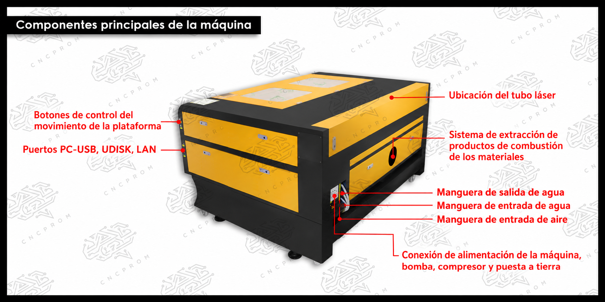
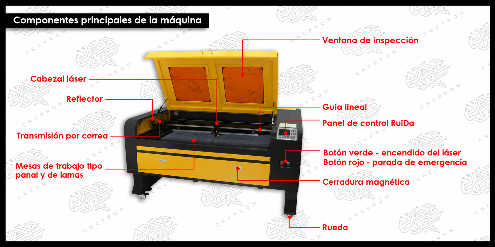
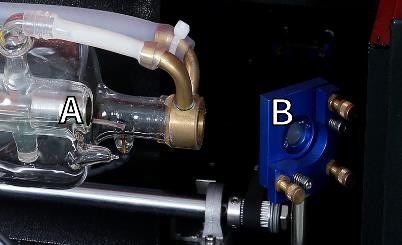
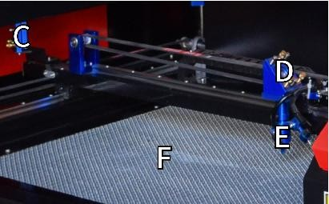
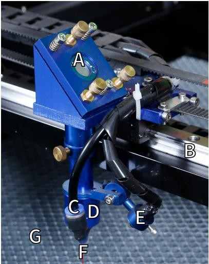

Descripción de componentes y sistema óptico
============================================

1. Descripción de la pieza
--------------------------
-  Ventana de visualización: Esta ventana de acrílico color canela le
   permite monitorear el proceso de grabado, pero absorbe solo parcialmente 
   el láser infrarrojo alto y no tiene otra protección. Siempre use
   anteojos cuando utilice el láser activo de observación protectora y
   nunca lo mire fijamente durante períodos prolongados.

-  Guías del eje Y: Las guías del eje Y permiten que las guías del eje X
   se muevan hacia adelante y hacia atrás sobre la mesa.

-  Interruptor de enfriamiento de agua: después de activar el interruptor,
   el agua incorporada El enfriamiento comienza y la pantalla de
   temperatura en tiempo real se ilumina.

- Riel del eje X: 
   El riel del eje X sostiene el segundo espejo y soporta el Cabezal láser para mover hacia la izquierda y la derecha.

-  Puerta delantera recta: esta puerta se abre para permitir el paso de
   materiales más grandes.A través de la mesa de trabajo. Se debe tener mucho cuidado para
   evitar ver o sufrir por el rayo láser y sus reflejos.

-  Puerta de acceso frontal: esta puerta proporciona acceso al área debajo
   del Banco para fácil limpieza.

-  Toldo: La tapa proporciona acceso al soporte principal para colocar y
   recuperación de materiales, así como la alineación de la trayectoria del
   láser y otras tareas de mantenimiento. Cuando se abre la tapa, la
   energía del láser se corta automáticamente.

-  Panel de control: El panel de control proporciona control manual del
   proceso de grabado, incluido el movimiento del cabezal láser manual y la
   emisión del láser.

-  Interruptor principal: controla el interruptor de potencia total de toda la máquina.

-  Puertos de conexión: Estos puertos conectan la placa principal de la máquina de grabado al ordenador de control y a su software de 
   grabado a travésde un cable USB o Ethernet.

-  Puerta de acceso derecha: esta puerta proporciona acceso a la placa
   base, al motor controladores y fuente de alimentación. Las rejillas de ventilación
   evitan que los componentes se sobrecalienten durante el uso y no
   deben estar obstruidas.

-  Interruptor de parada de emergencia: En caso de emergencia, este botón corta inmediatamente toda la energía al tubo láser.

-  Cabezal láser: El cabezal láser contiene el tercer espejo, la lente de enfoque y el punto rojo. Orientación y salida de asistencia de aire.

-  Mesa: La altura de la mesa se puede ajustar para adaptarse a
   superficies más delgadas y más gruesas. materiales, así como entre plataformas de aluminio y celulares.

-  Interruptor de control láser: este interruptor debe estar encendido
   cuando se utiliza un láser.

-  Interruptor de luz: Enciende la luz en el banco de trabajo.

-  Entrada de energía: este conector de alimentación debe estar conectado
   antes de usar el máquina.

-  Puerta de acceso trasera superior: esta puerta conduce al compartimento
   del láser donde se encuentra el láser. El tubo y sus conexiones están asegurados.

-  Puerta trasera: Esta puerta es el equivalente a una puerta delantera y requiere una puerta similar.

2. Descripción de la trayectoria del láser
------------------------------------------

A. Tubo láser : Este tubo de vidrio lleno de dióxido de carbono está
   montado sobre un soporte y no se puede mover. El voltaje de conexión
   entre él y la fuente de alimentación del láser es extremadamente alto
   y extremadamente peligroso.

B. Primer reflector: este espejo de ángulo ajustable se mantiene en su
   lugar para transferir el láser de grabado del tubo al segundo espejo.

   Tubo láser y primer reflector.

C. Segundo espejo : Este espejo de ángulo ajustable se mueve a lo largo
   de la guía del eje X para permitir que el rayo láser se desplace a lo
   largo del eje Y.

D. Tercer espejo : Este espejo ajustable en ángulo se mueve con el
   cabezal del láser, lo que permite que el rayo láser se desplace a lo
   largo del eje X.

E. Lente de enfoque : esta lente dirige y enfoca la luz láser sobre el
   material.

F. Banco de trabajo : La altura del banco de trabajo expuesto se puede
   ajustar .

   Segundo y tercer espejo, lente de enfoque y banco de trabajo.

3. Conjunto del cabezal láser
-----------------------------

A. Tercer espejo del cabezal láser: este espejo con ángulo ajustable
   transmite la luz láser desde el segundo espejo a la lente de enfoque.

B. Guía del eje X: Esta guía se mueve a lo largo del eje Y, y su
   movimiento está controlado por un interruptor de límite.

C. Asistencia de aire: este dispositivo sopla aire presurizado para
   matar chispas y eliminar gases y residuos mientras se graba.

D. Lente de enfoque: esta lente dirige y enfoca el rayo láser hacia su
   punto de contacto con el material de grabado.

E. Puntero de punto rojo: este dispositivo le ayuda a ver la ubicación
   exacta del láser de grabado invisible.

F. Láser: El láser de grabado es invisible, pero muy peligroso. Evite el
   contacto directo con la piel o los ojos.

G. Banco de trabajo: Utilice las herramientas acrílicas proporcionadas
   para lograr el enfoque perfecto para cualquier espesor de material.

   Conjunto del cabezal láser.
