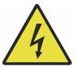

INFORMACIÓN DE SEGURIDAD
========================

1. Descargo de responsabilidad de garantías
-------------------------------------------

Su grabador puede ser ligeramente diferente al que se muestra en este
manual debido a opciones, actualizaciones, etc. Si su máquina de grabado
viene con un manual desactualizado o tiene alguna otra pregunta,
comuníquese con nosotros.

2. Aviso general de seguridad
-----------------------------

Su dispositivo debe tener una etiqueta de instrucciones adherida en las
siguientes ubicaciones:

-  Si alguna de estas etiquetas falta, es ilegible o está dañada, debe ser reemplazado.

-  Utilice este dispositivo de grabado láser únicamente de acuerdo con todas las normas aplicables. Leyes y reglamentaciones locales y nacionales.

-  Utilice este aparato únicamente de acuerdo con este manual de 
   instrucciones. Otras personas que hayan leído y comprendido este manual están
   autorizadas a instalar, operar, mantener, reparar, etc. Si este
   dispositivo ha sido regalado o vendido a un tercero, asegúrese de que
   este manual esté incluido con el dispositivo.

-  No corras de forma continua durante más de 3 horas y media. Haz una
   parada al menos 30 minutos entre usos.

-  No deje este dispositivo sin supervisión durante su funcionamiento.
   Observe durante todo el funcionamiento del equipo si se produce algún
   funcionamiento anormal. Si es necesario corte inmediatamente la alimentación de la
   máquina y póngase en contacto con nuestro servicio de atención al
   cliente o con su servicio de reparación especializado. Nuevamente,
   asegúrese de que el aparato esté completamente apagado después de
   cada uso (incluso a través del interruptor de parada de emergencia).

-  No permita que menores, personal no capacitado o personas con
   discapacidades físicas o discapacidades mentales que puedan interferir con su capacidad para
   seguir este manual y los manuales de software para instalar, operar,
   mantener o reparar este equipo.

-  Cualquier personal no capacitado que pueda estar cerca del equipo.
   Durante la operación se debe informar a los usuarios que el equipo es
   peligroso y recibir instrucciones adecuadas sobre cómo evitar lesiones
   durante su uso .

-  Coloque siempre extintores, tuberías de agua u otros retardantes de
   llama o sistemas de extinción de incendios cerca para evitar accidentes.
   Asegúrese de que el número de teléfono del departamento de bomberos
   local esté claramente visible cerca. En caso de incendio, corte el
   suministro eléctrico antes de apagar las llamas. Antes de usarlo,
   familiarícese con el alcance correcto del extintor. Tenga cuidado de
   no usar el extintor demasiado cerca de la llama, ya que su alta
   presión puede crear una reacción.

3. Instrucciones de seguridad del láser
---------------------------------------

Cuando se utiliza según las instrucciones, la máquina incluye un sistema
láser de clase 1 que es seguro tanto para los usuarios como para las
personas que se encuentren cerca. Sin embargo, los láseres invisibles,
los tubos láser y sus conexiones eléctricas siguen siendo muy
peligrosos. Pueden provocar graves daños materiales y lesiones
personales si no se utilizan o modifican con cuidado, incluidos, entre
otros, los siguientes:

-  Los láseres pueden quemar fácilmente materiales combustibles cercanos.

-  Algunos materiales de trabajo pueden producir radiación o gases nocivos
   durante Procesando .

-  El contacto directo con el láser puede provocar daños corporales,
   incluidos graves quemaduras y daños oculares irreparables.

-  No modifique ni desactive las funciones de seguridad proporcionadas por
   este dispositivo. No modifique ni desmonte el láser, y no lo utilice si ha sido
   modificado o desmontado por alguien que no sea un profesional
   capacitado y calificado. El uso de dispositivos láser adaptados,
   modificados o de otro modo puede provocar exposición peligrosa a la
   radiación y otras lesiones. equipo incompatible .

-  Nunca deje ninguna parte del gabinete abierta durante el funcionamiento
   a menos que (obligatorio) a través de puertas. Nunca interfiera con el haz láser,
   no coloque ninguna parte del cuerpo en ninguna parte de la
   trayectoria del láser durante la operación y nunca intente observar
   el láser directamente. Cuando utilice una puerta de paso o corra el
   riesgo de exponerse a un haz láser, tome medidas para protegerse de
   los rayos láser potencialmente reflejados, incluido el uso de equipo
   de protección personal, como gafas protectoras especialmente
   diseñadas, para filtrar grabadores con una densidad óptica (DO) de 5+
   para longitudes de onda específicas de láseres.

-  Durante el funcionamiento, no mire ni permita que otros miren el rayo
   láser de forma continua, incluso si la tapa está cerrada y/o se utilizan gafas protectoras.

-  Utilice esta máquina de grabado únicamente cuando su función de apagado
   automático esté activada y funcionando correctamente. Cuando adquiera este grabador por primera
   vez, si Si nota algún problema, pruébelo antes de realizar cualquier
   otro trabajo (consulte a continuación). Si no se cierra, no continúe
   usándolo. Apague el dispositivo y comuníquese con el servicio de
   atención al cliente o el servicio de reparación. Nunca desactive
   estos cierres.

-  Si el sistema de refrigeración por agua no funciona correctamente, no utilice este láser.
   No utilice el grabador bajo ninguna circunstancia. Active siempre el
   sistema de refrigeración por agua destilada y confirme visualmente que el agua
   fluye por todo el sistema antes de encender el tubo láser. No utilice
   agua helada ni agua con temperaturas superiores a 100 °F (38 °C).
   Para obtener mejores resultados, manténgala entre 60 y 70 °F (15 y 21
   °C).

-  No utilice refrigerante genérico ni anticongelante en el agua de
   enfriamiento, ya que pueden dejar un residuo corrosivo y se solidifican dentro de la manguera y
   las tuberías, lo que puede provocar fallas o incluso explosiones.
   Utilice fórmulas personalizadas seguras para láser o use y guarde su
   grabador en un área con clima controlado.

-  No deje sustancias potencialmente inflamables, explosivas
   o corrosivas cerca del equipo para evitar exponerlos a rayos láser directos o
   reflejados.

-  No utilice ni coloque equipos sensibles a interferencias
   electromagnéticas cerca. Asegúrese de que el área alrededor del láser está libre de fuertes interferencias
   electromagnéticas durante cualquier uso.

-  Utilice esta máquina únicamente para procesar los materiales descritos en sección de seguridad de materiales de este manual. La configuración
   del láser y el proceso de grabado deben ajustarse adecuadamente para el material específico.

-  Asegúrese de que el área esté libre de otros contaminantes del aire, ya
   que estos pueden representar un riesgo. 

   Símbolo de advertencia de riesgo eléctrico.

4. Instrucciones de seguridad eléctrica
---------------------------------------
-  Utilice este dispositivo únicamente con una fuente de alimentación
   compatible y estable con una fluctuación de voltaje inferior al 10 % .

-  No conecte otros dispositivos al mismo fusible que el sistema láser.
   requiere su amperaje completo. No utilice con cables de extensión
   estándar ni regletas de enchufes. Solo se utilizan dispositivos de
   protección contra sobretensiones con una capacidad nominal de más de
   2000 J.

-  Encienda este dispositivo solo si está bien conectado a tierra, ya sea
   mediante un cable firme. Conexión a un enchufe de 3 pines o mediante un cable de conexión a
   tierra exclusivo que esté conectado de forma segura a la ranura
   correcta del gabinete. No utilice un adaptador de 3 a 2 pines sin
   conexión a tierra. La conexión a tierra del equipo debe revisarse
   periódicamente para detectar daños o conexiones sueltas.

-  Por lo tanto, el área alrededor de este dispositivo de grabado láser
   debe mantenerse seco, bien ventilado y con un ambiente controlado para mantener la
   temperatura ambiente entre 40 y 95 °F (5 y 35 °C). Para obtener
   mejores resultados, mantenga la temperatura a 75 °F (25 °C) o menos.
   La humedad ambiente no debe superar el 70 %.

-  Cuando la bomba esté conectada a su fuente de alimentación, no manipule
   la bomba o el agua en la que está sumergida. Colóquela en el agua antes
   de conectarla a una fuente de energía y desconéctela de la fuente de
   alimentación antes de sacarla.

-  Ajustes, mantenimiento y reparaciones de los componentes eléctricos de
   este equipo debe ser utilizado únicamente por profesionales
   capacitados y calificados para evitar incendios y otras fallas,
   incluida la posible exposición a la radiación debido a daños en los
   componentes del láser. Dado que la prueba de los componentes
   eléctricos de este sistema de marcado requiere técnicas
   especializadas, se recomienda que dichas pruebas sean realizadas
   únicamente por fabricantes, vendedores u organizaciones de servicio
   de reparación.

-  A menos que se indique lo contrario, ajuste, mantenga y repare el
   aparato únicamente cuando esté apagado, desconectado de la alimentación y completamente enfriado.

5. Instrucciones de seguridad del material
------------------------------------------

- Es responsabilidad del usuario de esta máquina de grabado láser:

   Confirmar que el material que se va a procesar es capaz de soportar el
   calor del láser y no produce emisiones ni subproductos que sean
   perjudiciales para las personas cercanas o que infrinjan las leyes o
   normativas locales o nacionales. En particular, no utilice este
   equipo para procesar cloruro de polivinilo (PVC), teflón u otros
   materiales que contengan halógenos bajo ninguna circunstancia.

- Es responsabilidad del usuario de esta máquina de grabado láser:

   Asegúrese de que todas las personas presentes durante la operación
   tengan el equipo de protección personal adecuado para evitar lesiones
   causadas por emisiones y subproductos del material que se está
   procesando. Además de las gafas protectoras contra láser mencionadas
   anteriormente, es posible que se requieran gafas protectoras,
   máscaras o respiradores, guantes y otra ropa protectora exterior.

- Si el sistema de escape no funciona correctamente, no utilice este láser.

   No utilice la máquina de grabado bajo ninguna circunstancia.
   Asegúrese siempre de que el extractor de aire pueda eliminar el polvo
   y los gases del proceso de grabado de acuerdo con todas las leyes y
   normativas locales y nacionales aplicables. Si el extractor de aire o
   el tubo de escape fallan, deje de usarlo inmediatamente.

- Los usuarios deben tener especial cuidado al trabajar con materiales conductores.

   La acumulación de polvo y partículas ambientales
   puede dañar los componentes eléctricos, provocar cortocircuitos o
   tener otros efectos, incluida la radiación láser reflejada .

-  Esta máquina se puede utilizar de forma segura con los siguientes
   materiales:

1. plásticos .

* Acrilonitrilo butadieno estireno (ABS)

* Nailon (poliamida, PA, etc.)

* polietileno

*  Polietileno de alta densidad (polietileno de alta densidad,
   polietileno, etc.)

*  Tereftalato de polietileno orientado biaxialmente (BoPET, poliéster,
   poliester, etc.)

* Tereftalato de polietileno (PETG, PET-G, etc.)

* Poliimida (PI, Kapton, etc.)

* Polimetilmetacrilato (PMMA, acrílico, plexiglás, fluorita, etc.)

* Polioximetileno (POM, acetal, DL, etc.)

* Polipropileno (PP, etc.)

* estireno

2.otros.

* cartulina

* Cerámica, incluyendo cubertería, azulejos, etc.

* vaso

* cuero

* Papel y cartón

* goma

* Piedra, incluyendo mármol, granito, etc.

*  Textiles, incluidos algodón, ante, fieltro, cáñamo, etc. ·Madera,
   incluyendo corcho, MDF, contrachapado, madera de balsa, abedul,
   cerezo, roble, álamo, etc.

**Nota** : Consulte los parámetros recomendados para los materiales
de grabado más utilizados.

- Esta unidad no se puede utilizar con los siguientes materiales ni con ningún otro material

conteniéndolos:

*  Cuero artificial que contiene cromo hexavalente (Cr[VI]) debido a sus humos tóxicos

* Astato debido a sus humos tóxicos.

* Óxido de berilio, por sus humos tóxicos.

* Bromo, por sus humos tóxicos.

* Cloro, incluido el polivinil butiral (PVB) y el policloruro de vinilo (PVC, vinilo, Sintra, etc.), por sus humos tóxicos.

* Flúor, incluido el teflón (teflón, teflón, etc.), por sus humos tóxicos.

* Yodo, por sus vapores tóxicos.

* Metales, por su conductividad eléctrica y reflectividad

* Resinas fenólicas, incluidas diversas formas de resinas epóxicas, ya que producen humos tóxicos.

* Policarbonato (PC, Lexan, etc.) por sus humos tóxicos

   **Nota** : Para todos los demás materiales, si no está seguro acerca
   de la seguridad o capacidad de este dispositivo para ser utilizado
   con láser, consulte los Datos de seguridad del material.

Hoja de datos de seguridad (MSDS). Se presta especial atención a la
información sobre seguridad, toxicidad, corrosividad, reflectividad y
reacción a altas temperaturas. Alternativamente, comuníquese con
nuestro departamento de soporte para obtener más orientación.
