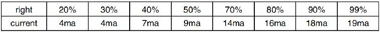
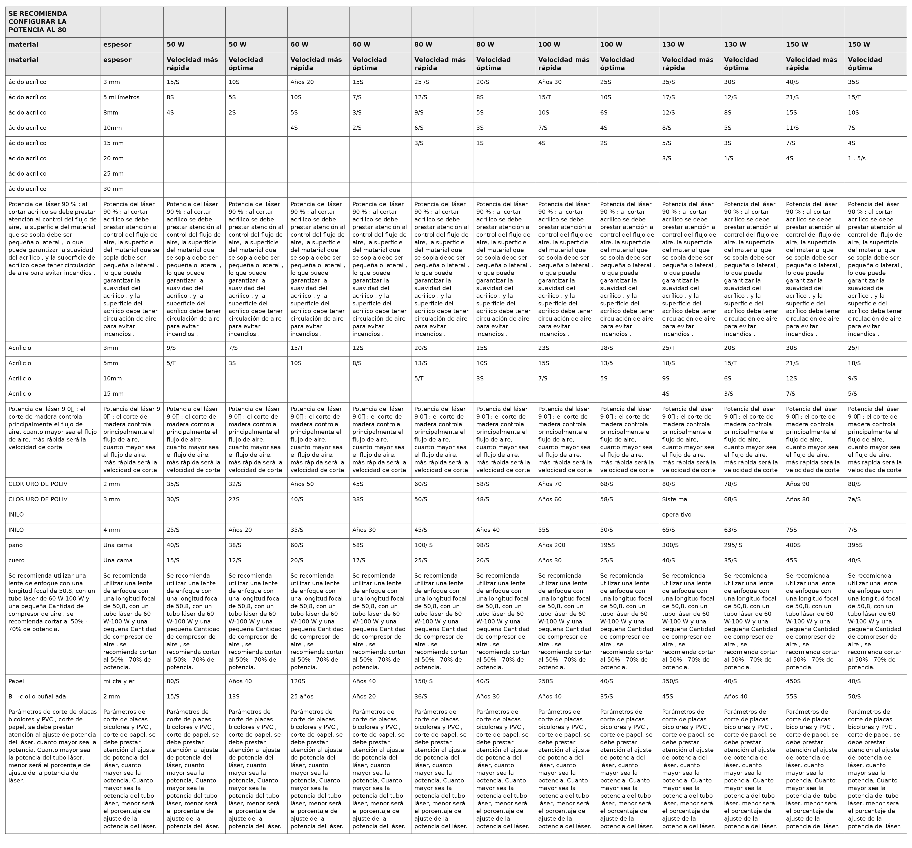

OPERACIÓN
=========

1. Descripción general del funcionamiento
-----------------------------------------
- Utilice este grabador láser únicamente siguiendo todas las
   instrucciones proporcionadas en este documento.
   El incumplimiento de las pautas adecuadas que se detallan en
   este documento puede provocar daños materiales y lesiones personales.

- En esta sección se describirán solo algunas de las opciones y
   características que ofrece el Software operativo. Antes de comenzar a utilizar la máquina,
   asegúrese de haber leído todo el manual (especialmente la información
   de seguridad mencionada anteriormente), así como todas las
   advertencias proporcionadas por la propia máquina.

2. Instrucciones generales de funcionamiento
--------------------------------------------
- Paso 1. 
   Crea el diseño que quieres grabar. Puedes hacerlo directamente
   en el software de grabado, o puede utilizar cualquier

- Paso 2. 
   Conecte el equipo complementario y las herramientas al producto
   y Conecte la fuente de alimentación.
   Llene la entrada de agua con agua purificada o destilada para la
   circulación de agua incorporada. El nivel del agua debe agregarse a la
   línea de seguridad de nivel de agua verde. Nota: (El nivel del agua no
   debe estar demasiado lleno, para no desbordarse ).

- Paso 3. 
   Retire el tubo de humo. Un extremo del tubo de humo está
   conectado al puerto de escape de humos del equipo y el otro extremo se
   conecta a un dispositivo de extracción de humos externo o auxiliar.
   Nota: (Utilice una abrazadera de tubo para asegurar la conexión y evitar
   que se caiga).

- Paso 4.
   Levante el botón de parada de emergencia y use los botones en
   la parte delantera del El gabinete permite abrir el panel de control de la máquina de
   grabado. Cargue el diseño que desee directamente desde una memoria
   USB o a través de la conexión de un ordenador a la grabadora.

- Paso 5. 
   Abra la cubierta del grabador, verifique que la asistencia de
   aire esté funcionando correctamente y ajuste la mesa si es necesario. Se recomiendan las camas celulares
   para la mayoría de las aplicaciones. La cama se puede elevar o bajar
   utilizando el control del eje Z en la parte frontal del gabinete para
   acomodar una variedad de materiales de diferentes espesores.

- Paso 6. 
   Coloque la muestra de material sobre la mesa. La posición
   estándar se encuentra en la esquina superior izquierda de la mesa. Esto se puede cambiar
   moviendo la ubicación de su diseño o el origen del grabador usando el
   panel de control o el software de grabado. Para manipular materiales
   más grandes, puede abrir la puerta de paso delantera o trasera, o
   ambas, al mismo tiempo. Cuando el láser esté activo, no inserte nada
   en la superficie de trabajo a través de una puerta de paso que no sea
   el material. Preste especial atención a los humos y el polvo que
   pueden liberarse a través de estas puertas. Asegúrese de que su
   sistema de ventilación sea lo suficientemente robusto como para
   absorber todos los subproductos o desgastar el material. EPI
   necesarios para garantizar la salud de los usuarios y transeúntes.

- Paso 7.
   Enfoque el láser colocando la herramienta de enfoque acrílico sobre el material.
   y levantando con cuidado la mesa. El cabezal del láser debe tocar
   apenas la parte superior de la herramienta de acrílico sin aplicar
   ninguna presión, asegurándose de que la distancia de grabado sea la
   correcta. (Nuevamente, nunca intente estar en la mesa sin material).
   De cualquier manera, el láser está enfocado. Cierre la tapa.

- Paso 8. 
   Personalice el contraste y la profundidad del grabado de su diseño ajustando
   parámetros en el software de grabado o directamente desde el panel de
   control. Si Las instrucciones de grabado detallan la configuración de potencia en
   miliamperios, utilice lo siguiente Tabla de conversión para encontrar
   la configuración de potencia adecuada:

   Tabla de conversión entre potencia configurada y corriente.

El umbral mínimo es del 10 %. El láser no emitirá ningún láser con un
valor inferior a este. No se recomienda utilizar el tubo láser a plena
carga, especialmente durante largos periodos de tiempo. La potencia
máxima recomendada se establece en el 70 %, ya que el uso prolongado de
una cantidad superior a esta acortará la vida útil del láser. Para
aumentar la profundidad del grabado, aumente la energía por unidad de
área incrementando la potencia del láser o el número de anillos o
reduciendo el parámetro de velocidad. Sin embargo, un grabado demasiado
profundo puede degradar la calidad de la imagen, especialmente en el
caso del material de revestimiento.

Al trabajar con nuevos materiales, tenga en cuenta que siempre debe
comenzar con el valor más bajo de sus posibles ajustes. Si el efecto no
es lo suficientemente fuerte, siempre puede repetirse más de una vez.
Vuelva a ejecutar el bucle de diseño o vuelva a ejecutarlo con
configuraciones más potentes hasta crear el efecto deseado. La
resolución debe establecerse generalmente en 500 puntos por pulgada. En
algunos casos, reducir la resolución de la imagen puede ayudar, lo que
reduce el efecto de quemado y Aumentar la energía de los pulsos y
mejorar así la calidad de las imágenes producidas en determinados
materiales, como ciertos plásticos.

- Paso 9.
   Abra el tubo láser insertando y girando la llave láser. Para
   reducir el Riesgo de descarga eléctrica: intente tocar el grabador con
   una sola mano a la vez una vez abierto el tubo láser.

- Paso 10.
   Presione ejecutar para pausar el proceso de grabado de su
   diseño. De manera similar, incluso si está Utilice gafas protectoras y no mire fijamente el láser activo de
   forma continua. Sin embargo, tenga cuidado con posibles problemas,
   como chispas o incendios, y esté preparado para apagar incendios
   rápidamente si es necesario.

- Paso 11.
   Una vez que el láser se detenga, verifique la calidad de la primera pasada y ajuste el láser.
   Ajuste los parámetros en el panel de control o en el software según
   sea necesario para producir el efecto deseado. Durante el grabado y
   el corte repetidos, controle regularmente el tanque de la bomba para
   mantener la temperatura del agua por debajo de los 100 °F (38 °C). Si
   se alcanza esta temperatura, deje de trabajar y permita que el
   grabador se enfríe antes de seguir usándolo.

- Paso 12.
   Cuando haya terminado de grabar, cierre el software de grabado
   y apague el dispositivo la máquina en el siguiente orden: encendido del láser, panel de
   control, ventilación, sistema de refrigeración por agua y botón de
   encendido de emergencia. Retire la llave del láser del panel de
   control.

- Paso 13.
   Limpie completamente el banco, vaciando el soporte inferior de
   cualquier residuo.

3. Descripciones específicas de materiales
-------------------------------------------

Las siguientes instrucciones son recomendaciones que pueden ayudar a
acelerar el trabajo seguro con una variedad de materiales. Los usuarios
deben investigar los requisitos de seguridad y grabado para sus
materiales específicos para evitar el riesgo de posibles problemas como
incendios, polvo peligroso, humos corrosivos y tóxicos. Una vez que sepa
que el producto es seguro o que cuenta con el equipo de protección
adecuado, puede ser útil grabar una matriz de prueba de pequeñas cajas
producidas a varias velocidades y configuraciones de potencia para
descubrir las configuraciones ideales para su diseño. O comience con un
bajo consumo de energía y una configuración rápida, vuelva a ejecutar el
diseño tantas veces como sea necesario, utilizando una intensidad de
láser que aumente progresivamente.

Cerámica
~~~~~~~~

Al grabar en cerámica, generalmente se utiliza una potencia media o
alta. El uso de más circuitos en lugar de una potencia más alta y una
velocidad más baja puede ayudar a evitar la rotura del material durante
el proceso de trabajo. Tenga en cuenta los riesgos para la salud que
plantea el polvo del grabado en cerámica, especialmente en aplicaciones
industriales repetitivas. Según el material y la carga de trabajo, es
posible que se requiera un ventilador o incluso un sistema de
ventilación completo para resolver el problema. De manera similar, es
posible que los operadores y otras personas en el área de trabajo deban
usar EPI respiratorios, como máscaras y respiradores.

Piedra
~~~~~~

Al tallar todo tipo de piedras, generalmente se utilizan potencias
medias y velocidades medias a rápidas. Al igual que con la cerámica y el
vidrio, tenga cuidado con el polvo que se genera (especialmente para
aplicaciones industriales repetitivas) y tome medidas similares para garantizar la seguridad de los usuarios y otras personas en el área de
trabajo.

Textiles
~~~~~~~~

Cuando se trata de tallar textiles como tela y lana, se suele utilizar
poca potencia y alta velocidad. Al igual que con el cuero, se debe
prestar especial atención a la posibilidad de fuego y polvo.

Vidrio
~~~~~~

Al grabar vidrio, generalmente se utilizan alta potencia y baja
velocidad. Al igual que con la cerámica, sería útil ejecutar más ciclos
en un ajuste más bajo para evitar grietas. Se debe tener cuidado al
grabar vidrio y fibras de carbono para evitar combinar ajustes que
produzcan una intensidad de láser suficiente para alterar la integridad
estructural de las fibras de sus componentes, lo que daría como
resultado marcas borrosas. Se debe usar equipo de protección personal
para evitar la exposición de ojos, nariz, boca y piel al polvo
proveniente del uso de cualquier tipo de material, especialmente para
aplicaciones industriales repetitivas. La ropa que se usa cuando se
trabaja con fibra de vidrio debe lavarse por separado después.

Cuero
~~~~~

Al grabar vidrio, generalmente se utilizan alta potencia y baja
velocidad. Al igual que con la cerámica, sería útil ejecutar más ciclos
en un ajuste más bajo para evitar grietas. Se debe tener cuidado al
grabar vidrio y fibras de carbono para evitar combinar ajustes que
produzcan una intensidad de láser suficiente para alterar la integridad
estructural de las fibras de sus componentes, lo que daría como
resultado marcas borrosas. Se debe usar equipo de protección personal
para evitar la exposición de ojos, nariz, boca y piel al polvo
proveniente del uso de cualquier tipo de material, especialmente para
aplicaciones industriales repetitivas. La ropa que se usa cuando se
trabaja con fibra de vidrio debe lavarse por separado después.

Metal
~~~~~

Las máquinas de grabado láser de CO2 no deben utilizarse para marcar,
grabar o cortar metal. Son más adecuadas para trabajar con
revestimientos aplicados a sustratos metálicos y se debe tener cuidado
de no intentar trabajar sobre el metal subyacente. Existe una variedad
de revestimientos disponibles específicamente para el grabado de CO2 y
los usuarios deben seguir las instrucciones proporcionadas, ya que los
parámetros varían según el producto y el metal. En general, el trabajo
del revestimiento de aluminio debe realizarse más rápido a una potencia
menor, mientras que el trabajo del revestimiento de acero puede
realizarse más lentamente a una potencia mayor.

Plásticos
~~~~~~~~~

El plástico utilizado para el grabado viene en muchos colores y grosores
diferentes y tiene muchos revestimientos y acabados diferentes. La
mayoría de los plásticos disponibles se pueden grabar y cortar bien con
láser. Los plásticos con superficies microporosas parecen proporcionar
los mejores resultados porque es necesario eliminar menos material de la
superficie. Al grabar plásticos, generalmente se utilizan
configuraciones de baja potencia y alta velocidad. Marcar y grabar con
demasiada potencia o una velocidad demasiado baja puede concentrar
demasiada energía en el punto de contacto, lo que hace que el plástico
se derrita. Entre otros problemas, esto puede producir una calidad de tallado deficiente, gases tóxicos e incluso
incendios. El grabado de alta resolución puede causar el mismo problema,
por lo que se deben preferir los diseños de resolución baja a media para
la mayoría de los plásticos.

Goma
~~~~

Las distintas composiciones y densidades del caucho dan como resultado
profundidades de grabado ligeramente diferentes. Se recomienda
encarecidamente probar muestras de caucho específico para obtener
mejores resultados. Al grabar caucho, a menudo se utiliza una
configuración de alta potencia constante y el efecto se crea variando la
velocidad del láser. Los materiales de caucho microcelular requieren
velocidades mucho más altas que el caucho estándar. El grabado de
cualquier tipo de caucho produce mucho polvo y gases. Según la carga de
trabajo, es posible que se requiera un equipo de protección personal
respirable o un sistema de ventilación completo para resolver el
problema.

Papel y cartón
~~~~~~~~~~~~~~

Al grabar una variedad de productos de papel, generalmente se utilizan
potencias bajas o medias y velocidades altas. Pruebe las muestras por
lote, ya que solo pequeñas diferencias de parámetros pueden distinguir
el efecto de ser demasiado claro del efecto de quemar el sustrato. Al
igual que con el cuero, se presta especial atención a la posibilidad de
incendio, así como al polvo generado durante las aplicaciones repetidas.

Madera
~~~~~~

Al igual que con el caucho, existen muchos tipos diferentes de madera, y
probar el material específico es esencial para obtener los mejores
resultados. En general, las tallas de madera con vetas y colores
consistentes son más uniformes. La madera anudada crea un efecto
desigual, mientras que la madera de resina crea un mayor contraste en
los bordes. Algunas maderas blandas, como la balsa, el corcho y el pino,
tallan bien (aunque con poco contraste) a potencias bajas o medias y a
altas velocidades. Otras fibras, como el abeto, pueden verse afectadas
por fibras desiguales y, a menudo, producirán malos resultados sin
importar lo que haga. Las maderas duras, como el cerezo y el roble,
tallan bien a potencias altas y velocidades bajas. Los productos de
madera artificial pueden variar de una marca a otra, principalmente en
función de la composición y la abundancia de su pegamento. El MDF
funciona bien, pero crea bordes oscuros cuando se corta.

Además del riesgo de incendio que presenta cualquier producto de madera,
se debe tener especial cuidado con el humo que desprende el pegamento
que se utiliza en la madera contrachapada y otras maderas artificiales.
Algunos son demasiado peligrosos para utilizarlos, mientras que otros
requieren una ventilación cuidadosa y aplicaciones industriales
repetidas con equipos de protección personal transpirables. También se
debe comprobar la toxicidad de la madera, ya que el polvo de algunas
maderas naturales, como la adelfa y el tejo, también puede provocar
náuseas y problemas cardíacos.

- Consulte Datos de uso .

Tabla de parámetros de corte del documento fuente
~~~~~~~~~~~~~~~~~~~~~~~~~~~~~~~~~~~~~~~~~~~~~~~~~~

La siguiente tabla se reproduce como imagen para conservar la estructura de
14 columnas del documento Word original. Los valores se mantienen como
aparecen en la fuente; no se han reinterpretado ni recalculado.

   Parámetros de corte incluidos en el documento fuente.
