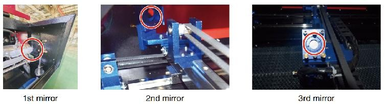
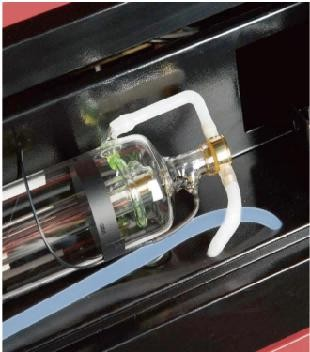
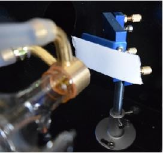
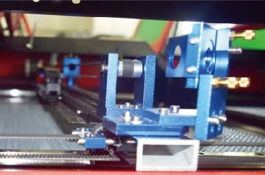
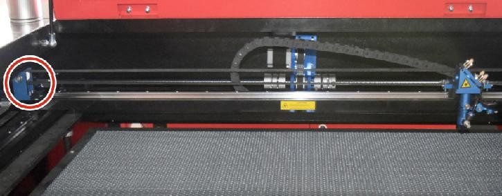
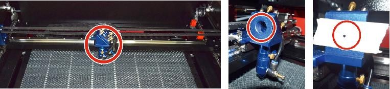
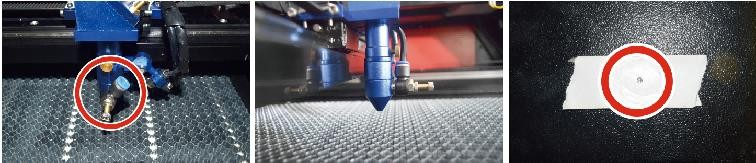
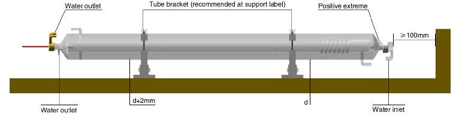

MANTENIMIENTO
=============

1. Descripción general del mantenimiento
----------------------------------------
El uso de procedimientos distintos a los especificados en este documento
puede provocar una exposición peligrosa a la radiación láser. Apague
siempre el aparato y desconéctelo de la fuente de alimentación antes de
realizar cualquier trabajo de limpieza o mantenimiento. Mantenga siempre
limpio el sistema, ya que los residuos inflamables en las áreas de
trabajo y de escape suponen un peligro de incendio. Solo los
profesionales capacitados y calificados pueden modificar o desmontar
este equipo.

* Se debe suministrar agua destilada limpia y fría al sistema en todo momento.

* El banco de trabajo debe limpiarse y el contenedor vaciarse todos los días.

* El tercer espejo y la lente de enfoque deben inspeccionarse diariamente y limpiarse si es necesario.

* Otros espejos y sistemas de escape deben inspeccionarse semanalmente y limpiarse si es necesario.

* La alineación del haz debe comprobarse semanalmente.

* El cableado debe revisarse semanalmente para detectar conexiones sueltas, especialmente en la fuente de alimentación del tubo láser.

* Los rieles deben limpiarse y lubricarse al menos una veces al mes.

* La asistencia de aire debe inspeccionarse una vez al mes y limpiarse si es necesario.

*   Toda la máquina láser, incluidos otros componentes como el sistema
    de refrigeración por agua, debe inspeccionarse una vez al mes y
    limpiarse si es necesario.

2. Sistema de refrigeración por agua
-------------------------------------

* Nunca toque ni ajuste el suministro de agua del grabador mientras la bomba esté parada.

* Conectado a la corriente.

*  El tubo láser debe enfriarse con agua destilada limpia para evitar
   sobrecalentamiento. Lo ideal es utilizar agua a temperatura ambiente o
   ligeramente más tibia. Los tubos láser requieren al menos 2 galones (7,5 litros) de agua destilada limpia y fría u otro refrigerante
   seguro para láser para evitar el sobrecalentamiento. Si la
   temperatura del agua está cerca de los 100 °F (38 °C), deje de trabajar hasta que se enfríe o
   encuentre una forma de bajar su temperatura sin interrumpir el
   suministro de agua del tubo láser. El agua tampoco debe enfriarse
   demasiado, ya que esto también puede hacer que el tubo láser de
   vidrio se rompa durante el uso. En los meses de invierno o si utiliza
   hielo para enfriar el agua caliente, asegúrese de que la temperatura
   nunca baje de los 50 °F (10 °C).

*  Se debe agregar más agua cada pocos días para garantizar la
   evaporación. no hace que la bomba quede expuesta durante el uso .

3. Limpieza
-----------

Limpieza del compartimento principal y de la máquina
~~~~~~~~~~~~~~~~~~~~~~~~~~~~~~~~~~~~~~~~~~~~~~~~~~~~

Compruebe al menos una vez al día si hay acumulación de polvo en la
cámara de grabado principal. Si es así, debe eliminarlo. Los intervalos
y requisitos de limpieza exactos dependen en gran medida del material
que se procesa y del tiempo de funcionamiento del equipo. Las máquinas
limpias garantizan un rendimiento óptimo y reducen los costos de
servicio, así como la riesgo de incendio o lesiones.

Limpie la ventana de visualización con un detergente suave y las lentes
o un paño de algodón. No utilice toallas de papel, ya que pueden rayar
el acrílico y reducir la capacidad de la tapa para protegerlo de la
radiación láser. Limpie a fondo el interior de la cabina principal para
eliminar cualquier residuo, partícula o sedimento. Se recomiendan
toallas de papel y limpiadores de ventanas. Si es necesario, limpie la
tapa del tubo láser después de que se haya enfriado por completo. Deje
que cualquier líquido utilizado en cualquier limpieza se seque por
completo antes de seguir utilizando el engaver .

Limpieza de la lente de enfoque
~~~~~~~~~~~~~~~~~~~~~~~~~~~~~~~

La lente tiene un revestimiento duradero que no se dañará con una
limpieza adecuada y cuidadosa.

Debes revisar la lente y el espejo al tercer día y limpiarlos si hay
residuos o neblina en la superficie. La eficiencia del láser se reducirá
y la acumulación de calor en el aceite o el polvo puede dañar la lente.

1.  Mueva la mesa de grabado a una distancia de aproximadamente 4
    pulgadas (10 cm) debajo de la montura de la lente.

2.  Mueva el cabezal del láser al centro de la mesa y coloque un paño
    debajo del soporte de la lente para que ésta no se dañe si se cae
    accidentalmente del soporte.

3.  Desatornille el soporte de la lente y gírelo hacia la izquierda.

4.  Retire la manguera de aire presurizado y la conexión del riel láser.

5.  Después de colocar la lente sobre papel de limpieza de lentes
    limpio, gire con cuidado el soporte de la lente para que la lente y
    su junta tórica caigan sobre el paño de limpieza y retire la lente
    de la montura.

6.  Revise la junta tórica y, si es necesario, límpiela con un hisopo de
    algodón y una toalla de papel o un paño para limpiar lentes.

7.  Sople aire sobre la superficie de la lente para eliminar la mayor
    cantidad posible de polvo grueso.

8.  Inspeccione la superficie de la lente y límpiela con una solución de
    limpieza de lentes y papel o paño para lentes si es necesario.

9.  Sujete el borde del conjunto de lentes con un pañuelo de papel y
    utilice una solución de limpieza de lentes. Sujete la lente en
    ángulo y enjuague ambas superficies para eliminar la suciedad.

10. Coloque las lentes sobre un paño de limpieza limpio y aplique un
    poco de solución limpiadora de lentes en un lado de la lente. Deje
    que el líquido actúe durante aproximadamente un minuto y luego
    limpie suavemente con papel de limpieza de lentes humedecido en
    solución limpiadora de lentes. Seque este lado de la lente con un
    paño limpio y seco.

11. Repita el mismo proceso de limpieza en el otro lado de la lente.
    Nunca utilice las toallas de papel de limpieza dos veces. El polvo
    que se acumula en las toallas de papel de limpieza puede rayar la
    superficie de la lente.

12. Revise la lente. Si aún está sucia, repita el proceso de limpieza
    anterior hasta que la lente esté limpia. No toque la superficie de
    la lente después de limpiarla.

13. Inserte con cuidado la lente en el soporte, asegurándose de que el
    lado convexo circular esté hacia arriba. Coloque la junta tórica en
    la parte superior de la lente.

14. Vuelva a ensamblar con cuidado la lente y el cabezal láser en el
	orden inverso.

Limpieza de los espejos
~~~~~~~~~~~~~~~~~~~~~~~

Si hay residuos o neblina en la superficie del espejo, también se debe
limpiar el espejo para mejorar el rendimiento y evitar daños
permanentes.

El primer disparo se encuentra detrás del lado izquierdo de la máquina,
más allá del extremo más alejado del eje Y. La segunda lente está en el
eje Y en el extremo izquierdo del eje X. La tercera lente está ubicada
en la parte superior del cabezal láser en el eje X. La mayor acumulación
de residuos se encuentra en el tercer espejo y se debe revisar a diario
con la lente de enfoque. La primera y la segunda lente se pueden revisar
a diario si es necesario, pero si solo se revisan una vez a la semana,
se recomienda limpiarlas a fondo.

Generalmente bien.

   Ubicación de los tres espejos del sistema óptico.

Los espejos se pueden limpiar en su lugar usando pañuelos o paños para
limpiar lentes, o se pueden quitar girándolos en sentido antihorario.
Tenga cuidado de no tocar la superficie del espejo directamente. Evite
presionar demasiado para no desgastar los residuos y causar rayones. Si
se quitan los espejos para limpiarlos, Vuelva a instalarlos girándolos
en el sentido de las agujas del reloj en su lugar teniendo cuidado de
evitar rayarlos.

4. Alineación de la trayectoria del láser
-----------------------------------------

La alineación adecuada del haz es muy importante para la eficiencia
general y la calidad del trabajo de la máquina. Esta máquina se alinea
completamente con el haz antes del envío. Sin embargo, cuando la
grabadora llega por primera vez, aproximadamente una vez a la semana
durante el funcionamiento normal, se recomienda al usuario que confirme
que la alineación aún se encuentra en un nivel aceptable y que el espejo
y la lente de enfoque no se mueven debido al movimiento de la máquina.

   Tubo láser y conexiones asociadas.

Será necesario colocar un trozo de cinta en cada etapa del recorrido del
láser, marcándolo para confirmar que la plataforma se mantiene
correctamente alineada. De lo contrario, utilizará el soporte del tubo
láser o los tornillos de la parte posterior del espejo desalineado para
corregir el problema. Una vez que se agoten las cintas suministradas, recomendamos
utilizar cintas de enmascarar, ya que son fáciles de manejar y usar.

Si la alineación del haz se realiza sin cuidado, el operador puede
quedar expuesto a una pequeña cantidad de radiación. Siga estos
procedimientos correctamente y tenga siempre cuidado al realizar la
alineación del haz realice la alineación del haz a niveles de potencia bajos: 15 % o menos.
Cualquier porcentaje superior hará que el láser encienda la tira de
prueba en lugar de marcarla. Asegúrese de configurar la potencia máxima
(no la mínima) al 15 %.

Alineación del tubo láser
~~~~~~~~~~~~~~~~~~~~~~~~~

Para probar la alineación del tubo láser con el primer espejo, corte una
tira de cinta y colóquela en el marco del espejo.

No coloque la cinta directamente sobre el espejo. Encienda la máquina y
ajuste el nivel de potencia al 15 % o menos.

Presiona PULSE para disparar el láser manualmente. Deberías poder ver
una pequeña marca en la cinta. Si no la detecta, presiona PULSE
nuevamente.

   Prueba de alineación entre el tubo láser y el primer espejo.

Pulse el pulso para activar el láser. Asegúrese siempre de que el camino
entre el láser y su objetivo no esté obstruido. Nunca permita que entren
objetos extraños entre el láser y su objetivo.

Botón PULSE, tenga cuidado de no dejar ninguna parte de su cuerpo en la
trayectoria del láser.

La marca del láser debe estar cerca del centro del orificio. Si el láser
no está centrado en el primer espejo, corte la alimentación del láser y
ajuste con cuidado el tubo láser en su soporte. Esto puede requerir
aflojar los pernos de su soporte. Tenga cuidado de no aflojar ni apretar
demasiado los pernos. Solo se puede ajustar un soporte a la vez.

Primera alineación de espejos
~~~~~~~~~~~~~~~~~~~~~~~~~~~~~

Después de asegurarse de que la luz láser esté correctamente alineada
entre el tubo láser y el primer espejo, verifique la alineación entre el
primer espejo y el segundo espejo. Primero, use las flechas
direccionales del panel de control para enviar el segundo espejo hacia
la parte posterior de la plataforma a lo largo del eje Y.

   Alineación del segundo espejo: primera posición de comprobación.

Una vez que esté fijado, coloque un trozo de cinta adhesiva en el marco
del segundo espejo. No coloque la cinta directamente sobre el espejo.
Repita el paso anterior. Si el láser no está centrado en el segundo
espejo, es necesario ajustar los tornillos de fijación del primer
espejo. por lo tanto.

Para ajustar el espejo, afloje la tuerca del tornillo y gire suavemente
el tornillo en el sentido de las agujas del reloj o en el sentido
contrario. Cada tornillo ajusta una posición o un ángulo diferente.
Lleve un registro de los tornillos que está ajustando y la dirección del
ajuste. No gire el tornillo más de 1/4 de vuelta a la vez, especialmente
pruebe la posición del láser después de cada ajuste para que pueda ver
el efecto de cada reemplazo. Pruebe hasta que los rayos estén
correctamente alineados, luego vuelva a apretar las tuercas de los
tornillos cuando se hayan realizado todos los ajustes.

A continuación, utilice las flechas direccionales del panel de control
para enviar el segundo espejo al frente de la cama a lo largo del eje Y.

   Alineación del segundo espejo: segunda posición de comprobación.

Una vez que se haya fijado, coloque otra tira de cinta en el marco del
segundo espejo. No coloque la cinta directamente sobre el espejo. Repita
los pasos del punto 5.4.1 y, si es necesario, ajuste los tornillos de
fijación del primer espejo. Pruebe nuevamente hasta que las vigas estén
correctamente alineadas y luego vuelva a apretar las tuercas de los
tornillos.

Segunda alineación de espejos
~~~~~~~~~~~~~~~~~~~~~~~~~~~~~

La marca del láser debe estar cerca del centro del orificio. Si el láser
no está centrado en el primer espejo, corte la alimentación del láser y
ajuste con cuidado el tubo láser en su soporte. Esto puede requerir
aflojar los pernos de su soporte. Tenga cuidado de no aflojar ni apretar
demasiado los pernos. Solo se puede ajustar un soporte a la vez.

   Comprobación de la alineación del segundo espejo.

Alineación del tercer espejo
~~~~~~~~~~~~~~~~~~~~~~~~~~~~

Después de asegurarse de que el láser esté correctamente alineado entre
el segundo y tercer espejo, verifique la alineación entre el tercer
espejo y la mesa. Primero, retire la manguera de asistencia de aire del
cabezal láser. Luego, coloque un trozo de cinta en la parte inferior del
cabezal láser y presiónelo firmemente contra la boquilla. Esto dejará
una marca de anillo que puede ayudarlo a verificar la precisión. Repita
los pasos del 5.4.1. Si el láser no está centrado a través del cabezal
láser, ajuste el tornillo de fijación del tercer espejo como se muestra
en el 5.4.2. Pruebe nuevamente hasta que los rayos estén correctamente
alineados, luego vuelva a apretar las tuercas de los tornillos.

   Comprobación de la alineación del tercer espejo.

Instalación del tubo láser
~~~~~~~~~~~~~~~~~~~~~~~~~~

Diagrama esquemático de la instalación del tubo láser:

   Diagrama esquemático de instalación del tubo láser.

1.  Instálelo de acuerdo con el logotipo del láser y conecte
	correctamente los cables de conexión del cátodo y el ánodo, la
	tubería de entrada de agua y la tubería de salida de agua del láser.

2.  Encienda el enfriador y ajuste el ángulo del láser para asegurarse de que el refrigerante llene el láser y no haya obstrucciones.

3.  Retire la marca de apertura óptica y luego encienda la fuente de alimentación del láser para la depuración de la trayectoria óptica.

Problemas y solución de problemas
~~~~~~~~~~~~~~~~~~~~~~~~~~~~~~~~~

- Problema 1: El láser siempre funciona a máxima potencia o la corriente no es ajustable.
	
	El láser está equipado con un terminal de control de potencia que
	está conectado incorrectamente; verifique cuidadosamente la conexión
	del terminal.

	El láser tiene un corte de energía; intente reemplazar la fuente de
	alimentación.

	Fallo en la placa de control de la máquina láser; comuníquese con el
	servicio de atención al cliente.

- Problema 2: El láser no emite luz.

	El láser está equipado con un terminal de control de potencia que
	está conectado incorrectamente o la línea de conexión de control está
	rota; verifique cuidadosamente si los terminales y los cables de
	conexión están mal conectados o no se encienden.

	La protección del agua del enfriador falla y el refrigerante del
	enfriador es insuficiente; reemplace el protector de agua o agregue
	refrigerante.

	Los láseres están equipados con fallas de energía o problemas de
	suministro de energía; intente reemplazar el cable de alimentación
	con una fuente de alimentación o un cable de alimentación de red.

	Fallo en la placa de control de la máquina láser; comuníquese con el
	servicio de atención al cliente.

	Fallo del láser; comuníquese con el servicio de atención al cliente.

- Problema 3: Ignición por descarga.

	La línea de conexión entre el láser y la fuente de alimentación
	equipada con láser está dañada o rota; intente reemplazar el cable.

	Falla del láser; comuníquese con el servicio de atención al cliente.

- Problema 4: Requisitos del medio ambiente.

	El láser está equipado con una fuente de alimentación y debe
	funcionar en un entorno bien ventilado.

	El espacio de trabajo debe cumplir con las normas de seguridad
	locales para el funcionamiento de equipos láser. Nota : Requisitos
	ambientales .

	Temperatura de funcionamiento: 10 °C ~ 38 °C

	Temperatura de almacenamiento: -10 °C ~ 35 °C Humedad de

	almacenamiento: 20 % HR ~ 80 % HR

5. Instrucciones de lubricación
-------------------------------

Para obtener mejores resultados, limpie y lubrique los rieles de la
máquina de grabado cada dos semanas (si el uso es continuo).

- Apague la máquina de grabado láser.

- Mueva suavemente el cabezal del láser para retirarlo del camino.

-   Limpie todo el polvo y los residuos de los rieles de los ejes X e Y con
    un paño de algodón seco hasta que queden brillantes y limpios.

- Haga lo mismo con los tornillos del eje Z.

- Lubrique los rieles y tornillos con grasa.

-   Mueva suavemente el cabezal láser y el eje X para que el lubricante se distribuya uniformemente
    a lo largo de los dos rieles, y subir y bajar la cama
    para distribuir uniformemente el lubricante a lo largo de los
    tornillos.
