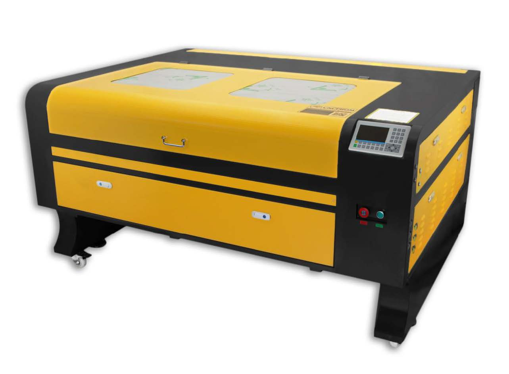

Máquina de láser R130100
=============================

1. Información general
------------------------

Este manual es una guía de usuario diseñada para la instalación, configuración, operación segura y mantenimiento del láser de gabinete. 
Incluye información general, instrucciones de seguridad, pasos de instalación, instrucciones de operación y procedimientos de mantenimiento.

Todo el personal involucrado en la instalación, configuración, operación, mantenimiento y reparación de esta máquina debe leer y comprender 
este manual, especialmente sus instrucciones de seguridad. Algunos componentes tienen voltajes extremadamente altos y/o generan una potente 
radiación láser. El no comprender y seguir estas instrucciones puede provocar un rendimiento y una vida útil deficientes, daños a la 
propiedad y lesiones personales .

La máquina es una cortadora láser es un equipo de alta tecnología de tipo cerrado destinado al grabado y corte de distintos materiales. 
Su componente principal es un potente láser de CO₂. Como medio de trabajo del emisor se utiliza una mezcla de gases compuesta por dióxido de carbono, nitrógeno y helio.

El láser de CO₂ permite procesar materiales frágiles porque el efecto térmico sobre el material está localizado, lo que evita alterar la integridad 
y el aspecto exterior de la pieza; el material no se somete a una acción mecánica directa.

La cortadora láser está equipado con mesas de trabajo tipo panal y de lamas de 1300 × 1000 mm. Gracias al mecanismo elevador 
de la mesa pueden procesarse piezas de distintos espesores. La profundidad máxima de descenso de la mesa es de 200 mm.

El desplazamiento del cabezal láser se realiza sobre guías lineales de tamaño HG15. La suavidad y precisión del movimiento se 
obtienen mediante motores paso a paso Leadshine Technology 57CM21X-M-L200 y una transmisión basada en correas y poleas dentadas HTD 3M.

Para detectar las posiciones extremas se emplean sensores inductivos FOTEK PL-05N (NPN). Como el tubo láser utiliza refrigeración por
agua, la circulación del líquido se realiza mediante una bomba XYH-075. El flujo de aire lo proporciona un compresor ACO-004.

La ventilación del gabinete y la extracción de los productos de combustión se realizan mediante un ventilador extractor CZR-LY80. El 
sistema de control de la máquina está basado en el controlador RuiDa RDC6445G(EC) y en drivers Leadshine Technology M542C. Todos los componentes del LM130100 están integrados en un gabinete metálico negro y amarillo/anaranjado.

El grabador láser funciona emitiendo un potente rayo láser desde un tubo de vidrio lleno de dióxido de carbono (CO2) aislante, reflejando
ese rayo en tres espejos y reflejándolo a través de una lente de enfoque, y utilizando esta luz enfocada para grabar el diseño en 
ciertos sustratos. El primer espejo está fijado cerca del extremo del tubo láser, el segundo espejo se desplaza a lo largo del eje 
Y de la máquina y el tercer espejo está unido al cabezal láser que se desplaza a lo largo del eje X. Dado que parte del polvo del 
proceso de grabado se deposita en el espejo, es necesario limpiarlo con frecuencia. Dado que se mueven durante el funcionamiento, 
también es necesario reajustarlos periódicamente con los tornillos de fijación a los que están unidos para mantener la trayectoria 
láser correcta. Con este grabador se debe utilizar un sistema refrigerado por agua (normalmente una bomba o un enfriador) para disipar 
el calor generado por el tubo láser. De forma similar, se debe utilizar un sistema de escape (normalmente un respiradero externo o 
un purificador de aire dedicado) para eliminar el polvo y los gases generados durante el proceso de grabado.

**Si utiliza el láser constantemente a más del 70 % de su potencia máxima, se acortará significativamente su vida útil.** Se recomienda 
configurarlo entre el 10 y el 70 % de la potencia máxima nominal para lograr un rendimiento y una longevidad óptimos.
Tenga en cuenta que este es un dispositivo de alto voltaje y, por razones de seguridad, se recomienda tocar sus componentes solo
con una mano a la vez durante su uso.

Tenga en cuenta que los láseres activos son invisibles para el ojo humano.

Este aparato no debe utilizarse con ninguna tapa abierta para evitar posibles lesiones permanentes.

También debe tenerse en cuenta que tanto el sistema de refrigeración por agua como el 
sistema de escape son absolutamente necesarios para el uso seguro de este equipo. 
No utilice la máquina de grabado sin que estos dos sistemas funcionen correctamente. El agua debe estar siempre limpia y a temperatura ambiente, y el sistema de escape debe 
cumplir siempre con todas las leyes y normativas aplicables al lugar de trabajo y a la calidad del aire ambiente.

**Uso previsto**

El equipo está destinado al **corte, marcado y grabado** de materiales que hayan sido previamente aprobados por el laboratorio para procesamiento con láser CO₂. El uso se limita a actividades de docencia, investigación, prototipado y fabricación autorizadas por la institución.

Quedan fuera del uso previsto:

* operar con tapas, puertas o interlocks anulados;
* procesar materiales desconocidos o sin identificación;
* usar el equipo sin refrigeración o extracción funcional;
* modificar parámetros de fabricante sin autorización;
* intervenir la fuente de alta tensión o el tubo láser por parte de estudiantes;
* dejar un trabajo láser sin supervisión.

2. Características del R130100
-------------------------------

•	Alta calidad de grabado y corte.
•	Alta velocidad de trabajo.
•	Bajo nivel de ruido y vibración durante el funcionamiento.
•	Ausencia de daños mecánicos en la pieza gracias al efecto térmico localizado.
•	Posibilidad de procesar distintos materiales no metálicos.
•	Cantidad mínima de residuos.
•	Mecanismo elevador de la mesa.
•	Sistema de extracción de los productos de combustión de los materiales.
•	Posibilidad de modificar los parámetros del trabajo desde el panel RuiDa o mediante software desde el computador.
•	Ventana de observación con función de protección contra incendios, según la descripción del documento.
•	Lámpara LED para iluminar el área de trabajo.
•	Compatibilidad con formatos de archivo que pueden importarse en CorelDRAW, como CDR, DtG, DXF, JPG, BMP, TIF, PCD, etc.

Resumen técnico
~~~~~~~~~~~~~~~~

.. list-table::
   :widths: 44 56
   :header-rows: 1

   * - Característica
     - Especificación
   * - Tipo
     - Cortadora/grabadora láser CO₂ de gabinete
   * - Área de trabajo
     - 1300 × 1000 mm
   * - Potencia nominal del tubo
     - 100 W
   * - Alimentación de la máquina
     - 110 V AC
   * - Frecuencia
     - 60 Hz
   * - Peso aproximado
     - 300 kg
   * - Controlador
     - Ruida 6445
   * - Software
     - RDWorks V8
   * - Refrigeración
     - Chiller externo de 550 W
   * - Accesorio rotativo
     - Eje por rodillos

**Advertencia: Para reducir el riesgo de lesiones, el usuario debe leer atentamente el manual de instrucciones.**

El grabador láser de CO2 es adecuado tanto para uso personal como profesional. Si se utiliza de acuerdo con estas 
instrucciones, incluye un sistema láser de clase 1, pero algunos componentes siguen siendo muy peligrosos. 

Nunca desactive el equipo de seguridad preinstalado y utilice siempre el láser de forma segura y responsable.
Antes de operar el equipo, el usuario debe leer atentamente las Manual de instrucciones y 
cúmplalo estrictamente. Este manual es aplicable a varios modelos de productos.

Este	equipo	utiliza	cuatro	tipos	de	láseres	estándar	internacionales
(fuerte radiación	láser).	La	radiación	láser	puede	provocar	los	siguientes
eventos:

1.	Encender los combustibles circundantes.

2.	Durante el procesamiento láser, debido a los diferentes objetos procesados, otros se pueden generar radiaciones y otros gases tóxicos.

3.	La radiación láser directa puede provocar lesiones personales. Por lo tanto, el equipo debe estar equipado con equipo contra incendios. 
	Está estrictamente prohibido apilar materiales inflamables y explosivos en el banco de trabajo 
	y alrededor del equipo. Al mismo tiempo, asegúrese de que haya una buena ventilación. 
	No se permite que los operadores no profesionales se acerquen al equipo.

-	Los objetos y emisiones que se procesen con láser deben cumplir con las leyes locale y reglamentos.

-	El procesamiento láser puede tener altos riesgos,por lo que debe considerarlo cuidadosamente
	si el objeto es adecuado para el procesamiento láser.

-	El equipo láser interno tiene alto voltaje y otros peligros, excepto para	los	operadores	del	equipo,	está 
	estrictamente	prohibido desmontarlo.

-	Al encender el equipo, alguien debe estar vigilado, Está prohibido salir sin autorización y se 
	debe cortar toda la energía antes de que el personal salga.

-	Está	prohibido	abrir	cualquier	puerta	cuando	el	equipo	esté	en funcionamiento.

-	Antes de iniciar la operación, este equipo y otros equipos deben conectado a tierra de forma segura y eficaz.

-	No coloque ninguna reflexión total irrelevante o reflexión difusa en el objeto.
	objetos en el equipo para evitar que el láser se refleje en el cuerpo humano o en objetos inflamables.

-	Durante el funcionamiento del equipo, el operador deberá siempre: Observe el funcionamiento del equipo. 
	Si ocurre una situación anormal, por favor, póngase en contacto con el servicio técnico de inmediato .

-	El equipo debe estar en un lugar seco, libre de contaminación y sin vibraciones. y fuerte
	entorno de interferencia electromagnética, con un funcionamiento temperatura de 5-40 grados centígrados y 
	una humedad de 5-95% (no ambiente de agua de condensación).

-	El equipo debe estar siempre alejado de equipos eléctricos
	sensible a las interferencias electromagnéticas, de lo contrario 
	podría causar interferencias electromagnéticas.

-	El voltaje de funcionamiento del dispositivo es: CA 110 V.

-	El láser de vidrio de dióxido de carbono más importante del equipo es a Consumible y un artículo vulnerable. 
	Por favor, cuídelo durante su uso. El láser de vidrio de dióxido de carbono necesita agua fría pura para enfriarse. 
	Por favor, preste atención a que la temperatura del agua no supere los 30 grados. Celsius durante el uso, de lo contrario 
	el láser se dañará. Cuando la temperatura ambiente esté a punto de caer por debajo de 0 grados Celsius, reemplácelo con un 
	líquido anticongelante para evitar dañar el dióxido de carbono. láser de vidrio.

-	Está	prohibido	encender	el	equipo	cuando	la	tensión	de	red	sea inestable
	o no coinciden. El fabricante y el vendedor no son responsables de ninguna pérdida causada por un uso incorrecto 
	o por el incumplimiento de las regulaciones anteriores.

Guía de simbolos
~~~~~~~~~~~~~~~~~

Los siguientes símbolos se utilizan en la etiqueta de esta máquina o en este manual:

.. list-table::
	:header-rows: 1
	:class: fit-table
	:widths: 5 30 20
	
	* - N°
	  - Descripción
	  - Imagen de referencia
	* - 1
	  - Estos artículos conllevan un riesgo de daños materiales graves o lesiones personales.
	  - .. image:: /_static/images/page_008_img_01.png
		:align: center
		:width: 120px
	* - 2
	  - Estos proyectos resuelven problemas graves similares relacionados con los rayos láser.
	  - .. image:: /_static/images/page_008_img_02.png
		:align: center
		:width: 120px
	* - 3
	  - Estos	proyectos	resolvieron	problemas	graves	similares	con	la electricidad.
	  - .. image:: /_static/images/page_008_img_03.png
		:align: center
		:width: 120px
	* - 4
	  - Cualquier persona que se encuentre cerca de la unidad debe usar gafas protectoras durante su funcionamiento.
	  - .. image:: /_static/images/page_008_img_04.png
		:align: center
		:width: 120px

Propósito de uso
~~~~~~~~~~~~~~~~~

-	La máquina es adecuada para grabar logotipos y otros artículos de consumo.
	productos sobre sustratos aplicables. Este láser puede procesar una variedad de materiales, incluidos madera y corcho, papel y cartón, 
	la mayoría de los plásticos, vidrio, tela y cuero, y piedra. También se puede utilizar con algunos metales con revestimiento especial. 
	No se permite el uso de este sistema para fines o materiales distintos de aquellos para los que está especificado.

-	El sistema debe ser operado, mantenido y reparado por una persona que está familiarizado con el campo de uso y los peligros de la 
	máquina y los materiales de grabado, incluyendo su reflectividad, conductividad eléctrica, potencial de producción de humos nocivos o 
	combustibles, etc.

-	Los	rayos láser son peligrosos.	El fabricante y/o vendedor no se hace responsable 
	del uso indebido de este dispositivo ni de los daños o lesiones que resulten de su uso. El operador tiene la 
	obligación de utilizar este grabador láser de gabinete únicamente de acuerdo con el uso previsto, las demás instrucciones del manual
	y todas las leyes y regulaciones locales y nacionales aplicables .

3. Especificaciones técnicas
-----------------------------

.. list-table::
	:widths: 44 56
	:header-rows: 1

	* - Parámetro
	  - Especificación
	* - Modelo
	  - 130100
	* - Tipo de láser
	  - CO₂
	* - Fabricante del tubo láser
	  - Beijing Reci Laser Technology
	* - Modelo del tubo láser
	  - W4
	* - Potencia nominal del tubo láser
	  - 100 W
	* - Potencia máxima del tubo láser
	  - 117 W
	* - Longitud del tubo láser
	  - 1400 mm
	* - Diámetro del tubo láser
	  - 80 mm
	* - Vida útil del tubo láser
	  - mas de 15 000 horas
	* - Tipo de refrigeración del tubo
	  - Por agua
	* - Fuente de alimentación del tubo
	  - ZYE Laser MYJG150W
	* - Potencia total consumida
	  - mayor/igual a  300 W
	* - Alimentación eléctrica
	  -  110 V ±10 % / 60 Hz
	* - Profundidad de corte
	  - 0...20 mm, según el material
	* - Velocidad de corte
	  - 1...50 mm/s
	* - Velocidad de grabado
	  - 1...500 mm/s
	* - Tamaño mínimo de letra para grabado
	  - 1 × 1 mm
	* - Resolución
	  - ≤ 1000 dpi
	* - Precisión de posicionamiento
	  - ≤ 0,01 mm
	* - Tiempo de funcionamiento continuo
	  - ≤ 12 horas
	* - Temperatura de trabajo
	  - 0...+45 °C
	* - Humedad relativa
	  - ≤ 80 % sin condensación
	* - Superficie de trabajo
	  - Panel tipo panal y panel de lamas
	* - Área de trabajo
	  - 1300 × 1000 mm
	* - Mecanismo elevador de la mesa
	  - Por cadena
	* - Motor del mecanismo elevador
	  - 4GN75K
	* - Profundidad de descenso de la mesa
	  - 200 mm
	* - Sistema de ventilación
	  - Sí, ventilador CZR-LY80
	* - Interfaces de conexión
	  - USB, memoria USB y Ethernet (LAN)
	* - Sistema operativo del PC
	  - Windows XP, 7, 8, 10
	* - Software
	  - RDWorks V8
	* - Controlador
	  - RuiDa RDC6445G(EC)
	* - Driver de motor
	  - Leadshine Technology M542C
	* - Formatos de archivo compatibles
	  - CDR, DWG, DXF, JPG, BMP, TIF, PCD, etc.
	* - Módulo de movimiento lineal
	  - HG15
	* - Correa dentada
	  - HTD 3M
	* - Motor paso a paso
	  - Leadshine Technology 57CM21X-M-L200
	* - Sensor inductivo
	  - FOTEK PL-05N (NPN)
	* - Dimensiones generales
	  - 1850 × 1390 × 990 mm
	* - Peso bruto
	  - 320 kg

4. Sistemas Auxiliares
----------------------
4.1 Bomba de agua XYH-075
=========================

.. list-table::
   :widths: 45 55
   :header-rows: 1

   * - Parámetro
     - Valor
   * - Alimentación
     - 220-240 V / 50 Hz
   * - Potencia
     - 75 W
   * - Altura máxima de impulsión
     - 3,2 m
   * - Caudal
     - 3200 L/h
   * - Temperatura máxima del agua
     - 35 °C
   * - Clase de protección
     - IPX8

**Bomba de agua XYH-075.**

4.2 Compresor de aire ACO-004
=============================

.. list-table::
   :widths: 45 55
   :header-rows: 1

   * - Parámetro
     - Valor
   * - Alimentación
     - 220 V / 50 Hz
   * - Potencia
     - 58 W
   * - Presión
     - 0,028 MPa
   * - Caudal
     - 75 L/min
   * - Diámetro de la salida
     - 8 mm

**Compresor de aire ACO-004.**

4.3 Ventilador extractor CZR-LY80
=================================

.. list-table::
   :widths: 45 55
   :header-rows: 1

   * - Parámetro
     - Valor
   * - Alimentación
     - 220 V / 50 Hz
   * - Potencia
     - 550 W
   * - Velocidad
     - 2800 rpm
   * - Caudal
     - 18 m³/min
   * - Presión
     - 1,7 kPa
   * - Diámetro de la salida
     - 80 mm

**Ventilador extractor CZR-LY80.**

