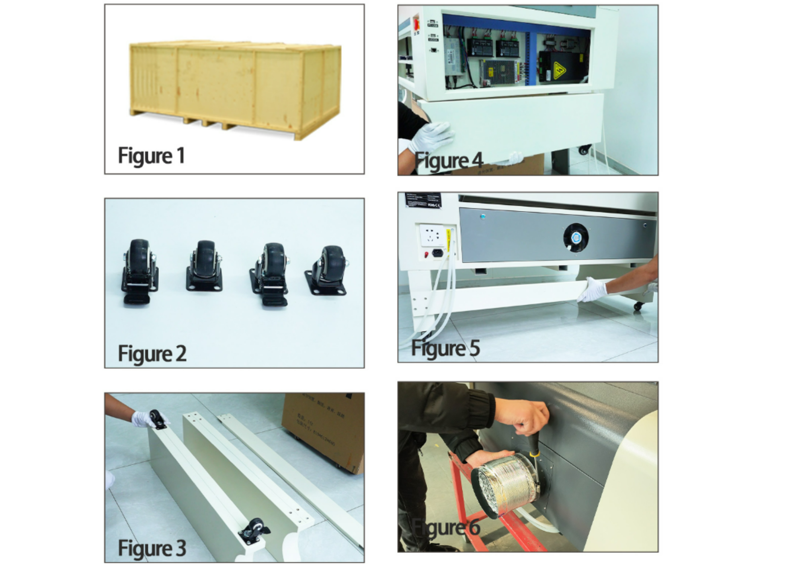
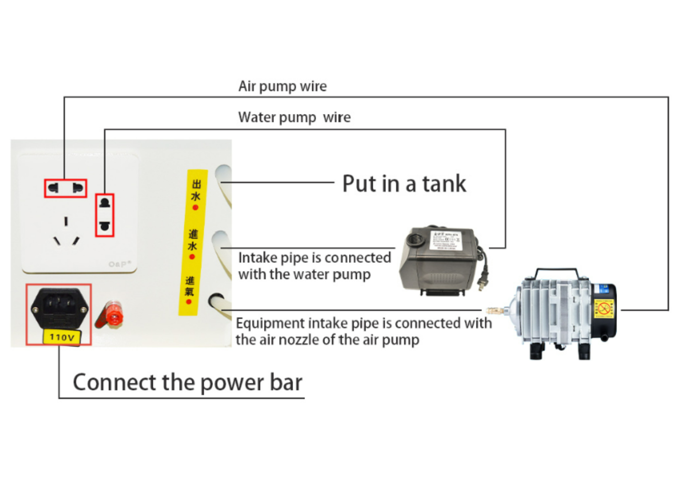
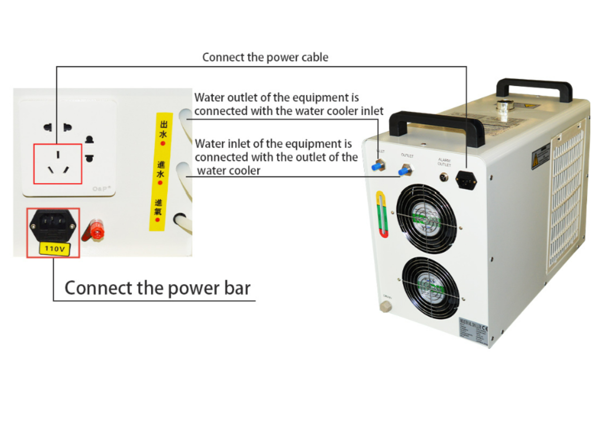
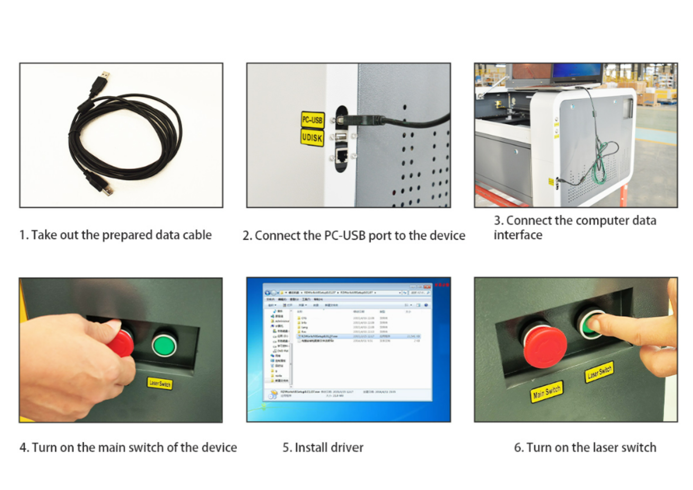
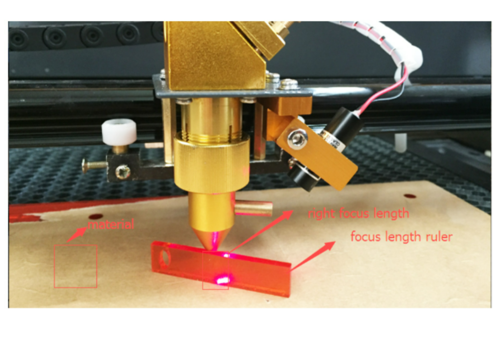
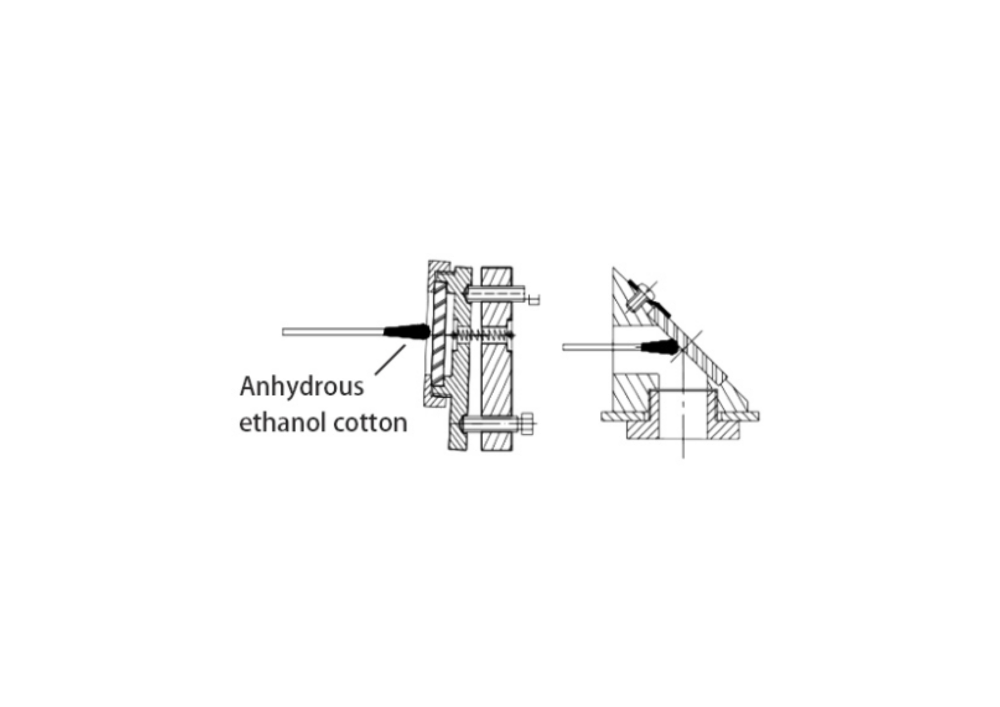

1. Instalación del equipo
==========================

La instalación inicial comprende el desembalaje, la colocación de las ruedas,
los soportes inferiores y el conducto de extracción de humo.

   Secuencia de instalación del producto traducida al español.

Procedimiento
-------------

#. Abra el embalaje del producto.
#. Compruebe los accesorios incluidos y retire las ruedas universales.
#. Instale las ruedas universales. Retire el soporte del producto, coloque la
   rueda universal en la parte inferior del soporte y apriete los tornillos.
#. Instale el soporte de las ruedas universales en la parte inferior del equipo.
#. Instale las vigas de soporte.
#. Instale el conducto de extracción de humo.

.. warning::

   Todas las operaciones de instalación deben realizarse con la alimentación
   eléctrica desconectada.

2. Conexiones
==============

Conexión de la bomba de aire y de la bomba de agua
--------------------------------------------------

   Conexión general de las bombas auxiliares.

El documento indica conectar los cables de alimentación de la bomba de aire y
de la bomba de agua a la barra de alimentación correspondiente. La bomba de
agua debe situarse en su depósito y las mangueras deben quedar firmemente
conectadas.

La tubería de entrada del equipo debe conectarse a la boquilla de salida de la
bomba de aire.

Conexión del chiller
--------------------

   Esquema traducido de conexión del sistema de refrigeración.

La salida de agua del equipo debe conectarse a la entrada de agua del chiller.
La entrada de agua del equipo debe conectarse a la salida de agua del chiller.

.. caution::

   Antes de conectar el chiller, el documento fuente indica que debe llenarse
   con agua. Para ambientes de baja temperatura menciona el uso de un
   anticongelante adecuado.

Conexión a una computadora
--------------------------

   Secuencia de conexión del computador.

#. Tome el cable de datos preparado.
#. Conecte el puerto ``PC-USB`` al equipo.
#. Conecte el cable de datos a la interfaz de datos del equipo.
#. Encienda el interruptor principal.
#. Instale el controlador o *driver*.
#. Encienda el interruptor del láser.

Una vez completada la conexión, puede comprobarse el funcionamiento normal
del equipo.

3. Ajuste del enfoque
======================

   Referencias para el ajuste de la distancia focal.

El espejo o conjunto de enfoque está instalado en el barril de enfoque.
Después de aflojar el tornillo de bloqueo del bloque de sujeción del cabezal
láser tipo lápiz, el barril de enfoque puede desplazarse hacia arriba o hacia
abajo.

Según el documento fuente, el plano focal se encuentra aproximadamente a
**7 mm** del borde inferior del barril de enfoque. La máquina incluye un bloque
de enfoque de aproximadamente **7 mm** de espesor para determinar el plano
focal.

Procedimiento de enfoque
------------------------

#. Coloque sobre la mesa el material que se va a procesar.
#. Coloque el bloque de enfoque sobre la superficie del material.
#. Afloje el tornillo de bloqueo del bloque de sujeción del cabezal láser.
#. Desplace el barril de enfoque hacia arriba o hacia abajo hasta que su
   superficie inferior haga contacto con el bloque de enfoque.
#. Compruebe que la superficie del material queda situada en el plano focal.
#. Ajuste la altura si fuera necesario y apriete nuevamente el tornillo de
   bloqueo.

Mantenimiento del equipo
========================

El documento describe el equipo como un sistema que integra elementos ópticos,
mecánicos y eléctricos. Para garantizar un uso seguro y un funcionamiento
normal, no debe abrirse la cubierta posterior ni modificarse la estructura
interna o el motor sin autorización.

Mantenimiento general
---------------------

#. Elimine el polvo de la guía antes de cada uso. El documento recomienda
   añadir aceite lubricante aproximadamente una vez cada tres meses y evitar
   que el aceite gotee.
#. Limpie oportunamente el agua, aceite y residuos presentes en la plataforma
   de trabajo.
#. Revise mensualmente las guías, accesorios y tornillos de fijación. Apriete
   los elementos que se encuentren flojos.
#. El sistema de extracción acumula polvo con facilidad; se recomienda
   limpiarlo como mínimo una vez por semana.

Agua de refrigeración
---------------------

El documento fuente recomienda mantener el agua limpia y libre de impurezas.
Indica los siguientes intervalos de sustitución:

* verano: una vez por semana;
* primavera y otoño: aproximadamente cada quince días;
* invierno: una vez por mes.

También advierte que las incrustaciones producidas por agua dura pueden
obstruir las tuberías y afectar el funcionamiento del láser.

.. warning::

   El texto fuente describe un procedimiento de desincrustación con ácido.
   Debido al riesgo químico y a la posibilidad de dañar el tubo, las tuberías
   o los sellos, cualquier procedimiento químico debe ser definido y ejecutado
   únicamente por personal técnico autorizado y de acuerdo con la documentación
   específica del fabricante del tubo y del chiller.

Mantenimiento de la lente
-------------------------

   Indicaciones traducidas para el mantenimiento de la lente.

La lente de enfoque y los reflectores son elementos ópticos sensibles. La
acumulación de polvo puede dañar el recubrimiento y disminuir la calidad del
grabado.

El documento señala:

* limpiar la lente con etanol anhidro;
* manipularla con cuidado porque es frágil;
* montar la lente cóncavo-convexa en la orientación indicada;
* sustituirla si el recubrimiento presenta daños.

Tubo láser
----------

El tubo láser es un consumible. Con el tiempo, el gas interno se consume y la
potencia disminuye. El documento indica que, si con la misma corriente el
grabado pierde profundidad, puede aumentarse moderadamente la corriente de
salida. Si incluso con el valor máximo permitido no se alcanza la potencia
necesaria, debe considerarse la sustitución del tubo láser.

4. Solución de problemas
=========================

Tabla de fallas comunes
--------------------------

.. list-table::
   :widths: 7 30 63
   :header-rows: 1
   :class: fit-table

   * - N.º
     - Falla
     - Método de solución
   * - 1
     - Autocomprobación anormal al encender
     - Revise la placa principal, el cable de señal, el trazador y la placa de
       control de iluminación.
   * - 2
     - Profundidad de grabado irregular
     - Apague el equipo, espere aproximadamente una hora y restablezca la
       circulación de agua antes de continuar.
   * - 3
     - No hay tensión al arrancar
     - Sustituya el fusible.
   * - 4
     - Grabado demasiado superficial
     - Ajuste la trayectoria óptica y limpie la lente.
   * - 5
     - Letras grabadas borrosas
     - Alinee la lente y ajuste la distancia focal especificada.
   * - 6
     - Descargas o ignición
     - Revise las conexiones, elimine el polvo y asegure ventilación y secado.
   * - 7
     - Desplazamiento o detención durante el grabado
     - Compruebe la puesta a tierra y sustituya el cable de datos o revise el
       computador.
   * - 8
     - La máquina no trabaja después de enviar los datos
     - Compruebe el cable de alimentación y el cable de datos.
   * - 9
     - El láser no emite
     - Compruebe el interruptor de alta tensión, el ajuste de corriente, la
       circulación del agua, la bomba, las tuberías y el estado del tubo láser.
   * - 10
     - Líneas redundantes durante el procesamiento
     - Compruebe el cable de datos y la conexión de tierra entre la máquina y
       el computador.
   * - 11
     - Líneas dentadas durante el corte
     - Reduzca la velocidad de corte.
   * - 12
     - Gráfico de salida incompleto
     - Compruebe que el diseño esté dentro del área de composición o trabajo
       del software.
