RuiDa RDC6445G
=================

Declaración de derechos de autor
---------------------------------

Shenzhen Reader Technology Co., Ltd. se reserva todos los derechos.

Shenzhen Reader Technology Co., Ltd. (en adelante, “RD Co., Ltd.”) posee los derechos de patente, derechos de autor y demás derechos de propiedad intelectual sobre este producto y su software relacionado. Sin autorización, ninguna persona puede copiar, fabricar, procesar ni utilizar este producto o sus componentes relacionados, directa o indirectamente.

RD Co., Ltd. se reserva el derecho de aumentar, reducir o modificar la forma y las funciones del producto descrito en este documento, así como de modificar cualquiera de los documentos adjuntos, sin previo aviso.

Los usuarios deben leer detenidamente este manual antes de utilizar el producto. RD Co., Ltd. no será responsable de pérdidas o daños directos, indirectos, especiales, incidentales o consecuentes derivados del uso incorrecto de este manual o del producto.

La máquina en funcionamiento puede ser peligrosa; por ello, los usuarios están obligados a diseñar e implementar mecanismos eficaces de gestión de errores y protección de seguridad. RD Co., Ltd. no asumirá responsabilidad por pérdidas incidentales o consecuentes derivadas de la ausencia o insuficiencia de dichos mecanismos.

1. Descripción general
======================

1.1 Presentación
----------------

El sistema RDC6445G es una nueva generación de controladores para máquinas de grabado y corte láser desarrollada por RD Co., Ltd. Además de una elevada estabilidad de hardware, resistencia frente a alta tensión y electricidad estática, y una interfaz hombre-máquina TFT de 5 pulgadas, el sistema incorpora funciones de software avanzadas: control completo de movimiento de cuatro ejes, almacenamiento de archivos de gran capacidad, dos canales independientes y ajustables para el control digital de potencia láser, compatibilidad mejorada con dispositivos USB y múltiples entradas/salidas generales y especiales. El sistema puede comunicarse con un PC mediante USB 2.0 o Ethernet y detecta automáticamente el modo de comunicación.

1.2 Descripción del modelo del controlador
------------------------------------------

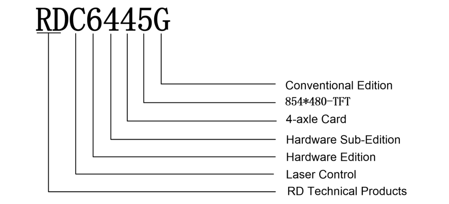

   Figura 1.2-1. Descomposición de la nomenclatura del modelo RDC6445G (figura original).

La nomenclatura del controlador identifica la familia de productos técnicos de RD, el control láser, la revisión de hardware, la subversión de hardware, la tarjeta de cuatro ejes, la pantalla TFT de 854×480 y la edición convencional.

1.3 Comparación de prestaciones de controladores
------------------------------------------------

.. list-table::
   :widths: 24 19 19 19 19
   :header-rows: 1
   :class: fit-table

   * - Característica
     - RDLC420
     - RDC6332G
     - RDC6342G
     - RDC644XG
   * - Alimentación
     - 5 V y 24 V independientes
     - 24 V; compatible con 36 V (no recomendado)
     - 24 V; compatible con 36 V (no recomendado)
     - 24 V; compatible con 36 V (no recomendado)
   * - Puertos láser
     - 1 digital y 1 analógico
     - 2 digitales + 2 analógicos, independientes
     - 2 digitales + 2 analógicos, independientes
     - 2 digitales, independientes y sin interferencia
   * - Velocidad de copia USB
     - Normal
     - Rápida
     - Rápida
     - Muy rápida
   * - Compatibilidad USB
     - Dispositivos de pequeña capacidad
     - Capacidades diversas
     - Capacidades diversas
     - Capacidades diversas
   * - Memoria
     - 64 MB
     - 256 MB
     - 256 MB
     - 128 MB
   * - Tolerancia a fallos de memoria
     - Normal
     - Detección de sectores defectuosos, formato y buena tolerancia
     - Detección de sectores defectuosos, formato y buena tolerancia
     - Detección de sectores defectuosos, formato y buena tolerancia

.. list-table::
   :widths: 24 19 19 19 19
   :header-rows: 1
   :class: fit-table

   * - Función
     - RDLC420
     - RDC6332G
     - RDC6342G
     - RDC644XG
   * - Entradas generales
     - 2
     - 4 (2 generales + 2 especiales)
     - 4 (2 generales + 2 especiales)
     - 4 (2 generales + 2 especiales)
   * - Salidas generales
     - 1 salida de baja corriente; requiere etapa adicional
     - 4 salidas de 500 mA, OC, sin protección de corriente inversa
     - 4 salidas de 500 mA, OC, sin protección de corriente inversa
     - 4 salidas de 500 mA, OC, con protección de corriente inversa
   * - Reanudación tras corte de energía
     - Sí
     - Sí
     - Sí
     - Sí
   * - Múltiples orígenes
     - No
     - Sí
     - Sí
     - Sí
   * - Respaldo de parámetros
     - No
     - Sí
     - Sí
     - Sí
   * - Vista previa del tiempo de trabajo
     - No
     - Sí, precisión de 1 ms
     - Sí, precisión de 1 ms
     - Sí, precisión de 1 ms
   * - Actualización en línea del programa de placa
     - No
     - Sí
     - Sí
     - Sí
   * - Modificación en línea de potencia/velocidad
     - Sí
     - Sí
     - Sí
     - Sí
   * - Modificación fuera de línea de capas
     - No
     - Sí
     - Sí
     - Sí
   * - Actualización en línea de pantalla de inicio
     - No
     - Sí
     - Sí
     - No
   * - Vista previa dinámica/estática de archivo
     - No
     - Sí
     - Sí
     - Sí
   * - Barra de progreso de ejecución
     - No
     - No
     - No
     - Sí
   * - Edición de parámetros fabricante/usuario desde panel
     - No
     - Sí
     - Sí
     - No
   * - Pantalla
     - 128×64, matriz de puntos
     - TFT 320×240
     - TFT 320×240
     - TFT 320×480
   * - Límite suave
     - Sí
     - Sí
     - Sí
     - Sí

.. list-table::
   :widths: 24 19 19 19 19
   :header-rows: 1
   :class: fit-table

   * - Característica de movimiento
     - RDLC420
     - RDC6332G
     - RDC6342G
     - RDC644XG
   * - Límite físico
     - No
     - Sí
     - Sí
     - Sí
   * - Enlace del eje Z
     - No
     - Sí
     - Sí
     - Sí
   * - Alimentación
     - Unidireccional
     - Uni/bidireccional seleccionable
     - Uni/bidireccional seleccionable
     - Uni/bidireccional seleccionable
   * - Restablecimiento al encender
     - Fijo
     - Configurable por eje
     - Configurable por eje
     - Configurable por eje
   * - Velocidad por teclas
     - Fija
     - Configurable
     - Configurable
     - Configurable
   * - Número de ejes
     - 4
     - 3 (Z configurable como eje plano o alimentación)
     - 3 (Z configurable como eje plano o alimentación)
     - 4
   * - Cifrado
     - Basado en hora del PC
     - RTC + batería para cifrado de hardware
     - RTC + batería para cifrado de hardware
     - Sin RTC; cifrado integrado
   * - Comunicación
     - USB 2.0
     - Ethernet 10/100 MHz o USB 2.0
     - Ethernet 10/100 MHz o USB 2.0
     - Ethernet 10/100 MHz o USB 2.0; detección automática

2. Dimensiones de instalación
=============================

2.1 Dimensiones de instalación de la placa principal
----------------------------------------------------

Todas las dimensiones se expresan en milímetros (mm) y tienen una precisión de 0,1 mm. Los cuatro orificios de montaje son simétricos.

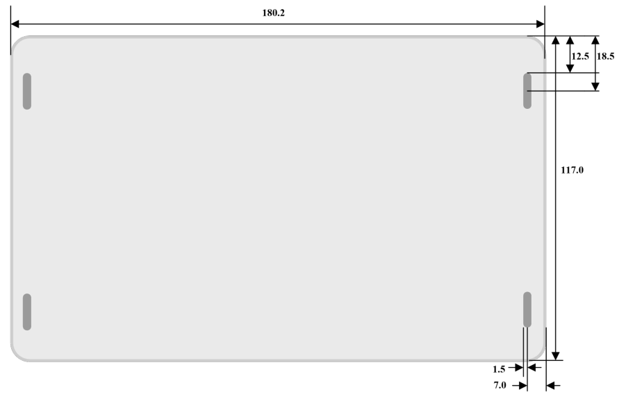

   Figura 2.1-1. Dimensiones de instalación de la placa principal (figura original).

2.2 Dimensiones del panel
-------------------------

Todas las dimensiones se expresan en milímetros (mm) y tienen una precisión de 0,1 mm.

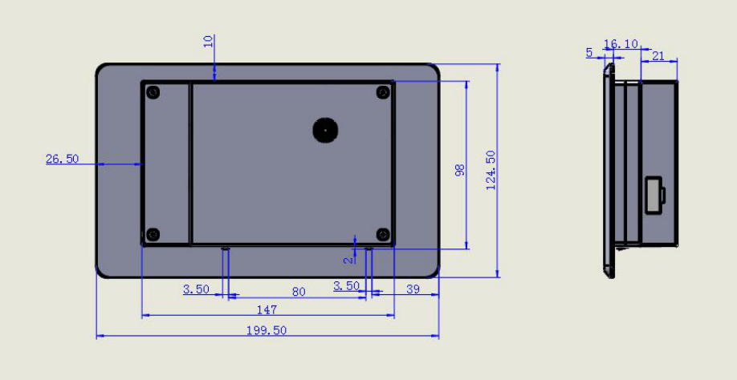

   Figura 2.2-1. Dimensiones del panel (figura original).

3. Imágenes del equipo e interfaces
===================================

3.1 Imagen de la placa principal
--------------------------------

Para una descripción detallada de los pines, consulte el capítulo 4, “Descripción de las señales de interfaz de la placa principal”.

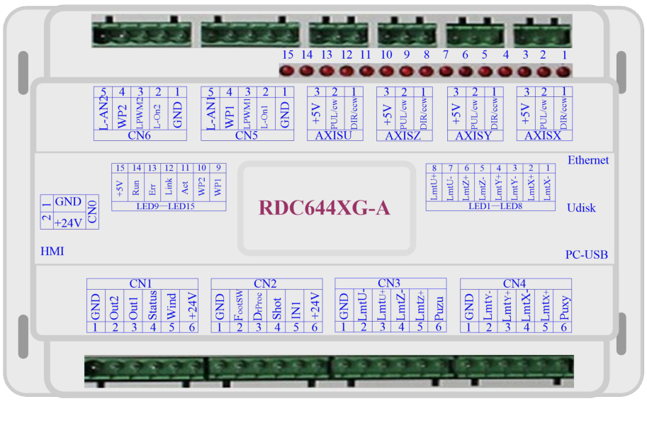

   Figura 3.1-1. Placa principal RDC644XG (figura original).

3.2 Imagen del panel
--------------------

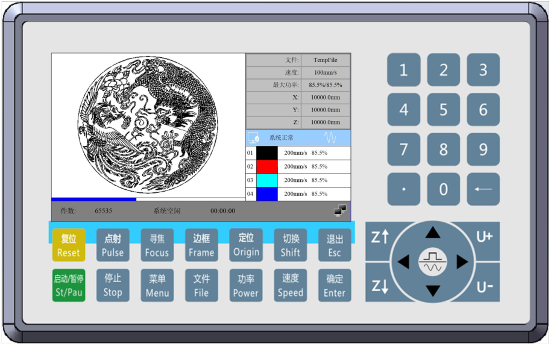

   Figura 3.2-1. Panel de control (figura original).

3.3 Conexión eléctrica
----------------------

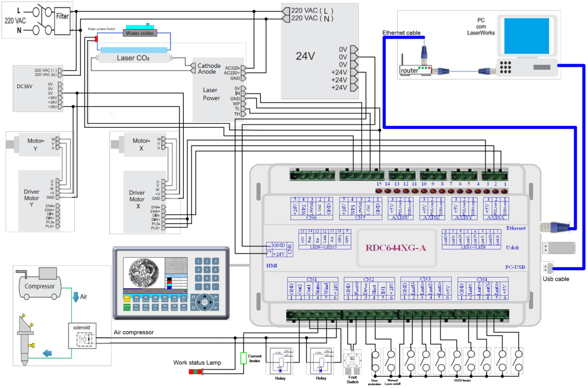

   Figura 3.3-1. Esquema general de conexión eléctrica (figura original).

3.4 Indicadores LED
-------------------

El RDC6445G dispone de quince indicadores LED rojos:

.. list-table::
   :widths: 12 23 65
   :header-rows: 1
   :class: fit-table

   * - LED
     - Nombre
     - Significado
   * - LED1
     - LmtX-
     - Indicador de límite negativo del eje X
   * - LED2
     - LmtX+
     - Límite positivo del eje X
   * - LED3
     - LmtY-
     - Límite negativo del eje Y
   * - LED4
     - LmtY+
     - Límite positivo del eje Y
   * - LED5
     - LmtZ-
     - Límite negativo del eje Z
   * - LED6
     - LmtZ+
     - Límite positivo del eje Z
   * - LED7
     - LmtU-
     - Límite negativo del eje U
   * - LED8
     - LmtU+
     - Límite positivo del eje U
   * - LED9
     - Wp1
     - Protección de agua 1
   * - LED10
     - Wp2
     - Protección de agua 2
   * - LED11
     - Act
     - Comunicación Ethernet
   * - LED12
     - Link
     - Enlace Ethernet
   * - LED13
     - Err
     - Error de hardware del controlador
   * - LED14
     - Run
     - Estado normal de funcionamiento
   * - LED15
     - +5V
     - Alimentación de +5 V

4. Descripción de las señales de interfaz de la placa principal
===============================================================

4.1 Interfaz de alimentación principal CN0
------------------------------------------

.. list-table::
   :widths: 12 23 65
   :header-rows: 1

   * - Pin
     - Símbolo
     - Definición
   * - 1
     - GND
     - Masa de alimentación de 24 V (entrada)
   * - 2
     - +24V
     - Positivo de alimentación de 24 V (entrada)

.. caution::

   Este sistema de control utiliza una única fuente de 24 V. Para disponer de margen suficiente, se recomienda una fuente de 24 V / 2 A. El sistema es compatible con alimentación de 36 V, por lo que la fuente de 36 V del driver de movimiento puede conectarse directamente a este puerto principal, aunque en general no se recomienda hacerlo.

4.2 Interfaz HMI del cable de señal del panel
---------------------------------------------

El cable de señal del panel es un cable pin a pin y se suministra de fábrica con el controlador.

4.3 Interfaz UDisk
------------------

UDisk utiliza una interfaz USB tipo A (macho). El controlador accede a la memoria USB a través de esta interfaz.

4.4 Interfaz PC-USB
-------------------

PC-USB utiliza una interfaz USB tipo B. El controlador puede comunicarse con el PC a través de este puerto.

4.5 Interfaz Ethernet
---------------------

Mediante esta interfaz, la placa principal puede comunicarse con un PC mediante Ethernet 10/100 MHz.

.. caution::

   Se recomienda utilizar un cable Ethernet directo pin a pin.

4.6 Puerto de salida general CN1
--------------------------------

.. list-table::
   :widths: 12 23 65
   :header-rows: 1
   :class: fit-table

   * - Pin
     - Símbolo
     - Definición
   * - 1
     - GND
     - Masa de alimentación (salida)
   * - 2
     - Out2
     - Salida general; función reservada.
   * - 3
     - Out1
     - Salida general; función reservada.
   * - 4
     - Status
     - Salida general de estado de funcionamiento. Si se conecta externamente a un relé, la bobina se activa durante el trabajo; no cambia durante una pausa. Al finalizar el trabajo o detenerlo manualmente, la bobina del relé se desactiva.
   * - 5
     - Wind
     - Salida general para el control del soplador. Cuando el control del soplador está habilitado, este puerto emite su señal de control; de lo contrario puede utilizarse para otras señales especiales. Si se emplea un relé externo, su bobina se activa con el soplador encendido y se desactiva al apagarlo. El estado del soplador puede configurarse por capa.
   * - 6
     - +24V
     - Salida positiva de alimentación. Será 24 V si el controlador se alimenta con 24 V, o 36 V si se alimenta con 36 V.

.. note::

   Todas las salidas están aisladas mediante optoacopladores. Cada salida puede suministrar hasta 500 mA, es de colector abierto (OC) y puede accionar directamente un relé de 6 V o 24 V.

4.7 Puerto de entrada general CN2
---------------------------------

.. list-table::
   :widths: 12 23 65
   :header-rows: 1
   :class: fit-table

   * - Pin
     - Símbolo
     - Definición
   * - 1
     - GND
     - Masa de alimentación (salida)
   * - 2
     - FootSW
     - Entrada para pedal. Al pisarlo se aplica un nivel bajo; al soltarlo la entrada queda abierta o recibe nivel alto. Si el pedal permanece presionado al menos 100 ms: con la máquina en reposo inicia el trabajo; durante el trabajo lo pausa; en pausa lo reanuda. Su función equivale a la tecla Inicio/Pausa. Si una segunda pulsación ocurre con menos de 100 ms de separación respecto a la primera, la placa la considera inválida.
   * - 3
     - DrProc
     - Entrada de protección. Se utiliza para condiciones especiales, por ejemplo protección por puerta abierta. Puede habilitarse o deshabilitarse. Si está habilitada, un nivel alto o una entrada abierta activa la protección, pausa el trabajo y desactiva el láser.
   * - 4
     - Shot
     - Entrada manual de encendido/apagado del láser. Nivel bajo: láser activado; nivel alto o sin conexión: láser desactivado.
   * - 5
     - IN1
     - Entrada general; función reservada.
   * - 6
     - +24V
     - Salida positiva de alimentación: 24 V con alimentación principal de 24 V o 36 V con alimentación principal de 36 V.

4.8 Interfaz de entrada de límites de cuatro ejes CN3/CN4
---------------------------------------------------------

Para X/Y se utiliza CN4:

.. list-table::
   :widths: 12 23 65
   :header-rows: 1

   * - Pin
     - Símbolo
     - Definición
   * - 1
     - GND
     - Masa (salida)
   * - 2
     - LmtY-
     - Límite Y- / coordenada 0 del eje Y
   * - 3
     - LmtY+
     - Límite Y+ / coordenada máxima del eje Y
   * - 4
     - LmtX-
     - Límite X- / coordenada 0 del eje X
   * - 5
     - LmtX+
     - Límite X+ / coordenada máxima del eje X
   * - 6
     - Puxy
     - Salida positiva de 5 V

La polaridad de los límites puede configurarse. Cuando un eje alcanza el límite, puede generar una señal de nivel bajo y encender el LED correspondiente; al abandonar la posición de límite, la señal pasa a nivel alto o se desconecta y el indicador se apaga. Una configuración incorrecta de la polaridad puede impedir la detección del límite durante el reinicio y provocar una colisión del eje.

Las definiciones de pines de las entradas de límite Z/U en CN3 son equivalentes a las de CN4. Todas las entradas de límite de los ejes X, Y, Z y U son compatibles con niveles lógicos de 5 V, 12 V y 24 V.

4.9 Interfaz de drivers de motor X/Y/Z/U: AXIS_X a AXIS_U
---------------------------------------------------------

Las interfaces de los cuatro ejes de movimiento son iguales. Se toma AXIS_X como ejemplo:

.. list-table::
   :widths: 12 23 65
   :header-rows: 1

   * - Pin
     - Símbolo
     - Definición
   * - 1
     - DIR
     - Señal de dirección (salida OC)
   * - 2
     - PUL
     - Señal de pulsos (salida OC)
   * - 3
     - +5V
     - Salida positiva de 5 V

La polaridad de la señal de dirección puede configurarse. Si durante el reinicio un eje se desplaza en sentido contrario al origen de máquina, la polaridad de dirección de ese eje es incorrecta. En ese caso debe desconectarse temporalmente el enlace entre el eje y su driver para evitar una colisión por falta de detección del límite, corregir la polaridad y volver a reiniciar la placa.

La señal de pulsos puede configurarse para ser válida por flanco descendente o flanco ascendente. El valor predeterminado es flanco descendente.

.. note::

   Las señales PUL y DIR son salidas de colector abierto (OC). El controlador y el driver del motor deben conectarse con ánodo común.

4.10 Interfaz de control de potencia láser CN5/CN6
--------------------------------------------------

El sistema dispone de dos interfaces digitales independientes y ajustables para el control de potencia láser. Ambas son similares; se toma CN5 como ejemplo:

.. list-table::
   :widths: 12 23 65
   :header-rows: 1
   :class: fit-table

   * - Pin
     - Símbolo
     - Definición
   * - 1
     - GND
     - Masa de alimentación (salida)
   * - 2
     - L-ON1
     - Habilitación del láser. Para láser RF normalmente no se utiliza. Para tubo de vidrio con habilitación activa a nivel bajo, se conecta a la entrada de habilitación de la fuente y controla el encendido/apagado del láser.
   * - 3
     - LPWM1
     - Control de potencia. Para láser RF se conecta a RF-PWM. Para tubo de vidrio se conecta a la entrada PWM de la fuente de potencia y controla la potencia del láser.
   * - 4
     - WP1
     - Entrada de protección de agua de la fuente láser 1. Si la protección está habilitada, nivel bajo se considera normal; nivel alto provoca el cierre forzado del láser, pausa el trabajo y genera una alarma. Si está deshabilitada, la entrada no se supervisa. La entrada de protección de agua debe ser de nivel lógico 24 V.
   * - 5
     - L-AN1
     - Señal analógica de potencia láser. Si se utiliza tubo de vidrio, se recomienda este pin para controlar la potencia.

.. note::

   Seleccione correctamente el tipo de láser en los parámetros de fábrica.

5. Ejemplos de interfaz de potencia láser
=========================================

5.1 Descripción
---------------

El sistema dispone de dos interfaces digitales independientes y ajustables para el control de potencia láser. Pueden emplearse tanto con fuentes para tubos láser de vidrio como con láseres RF. Es imprescindible seleccionar correctamente el tipo de láser en los parámetros de fábrica; de lo contrario, el control del láser será incorrecto.

5.2 Ejemplo con tubo láser de vidrio
------------------------------------

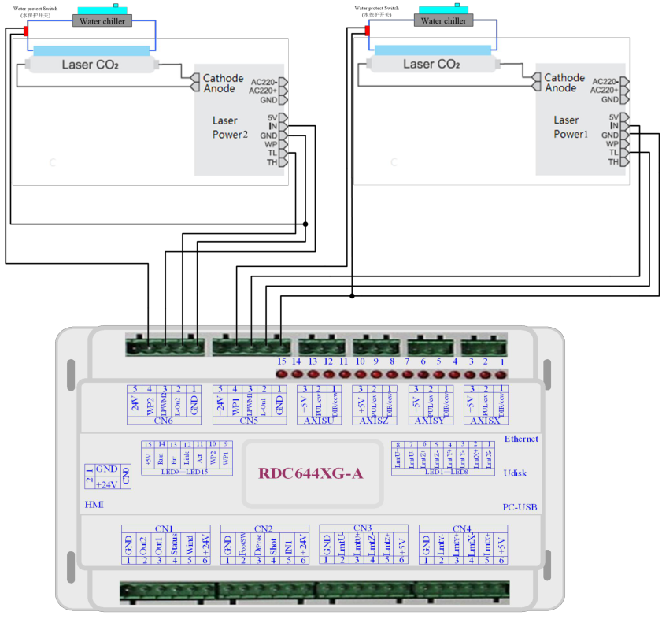

   Figura 5.2. Ejemplo de conexión de dos fuentes para tubos láser de vidrio (figura original).

5.3 Ejemplo con láser RF
------------------------

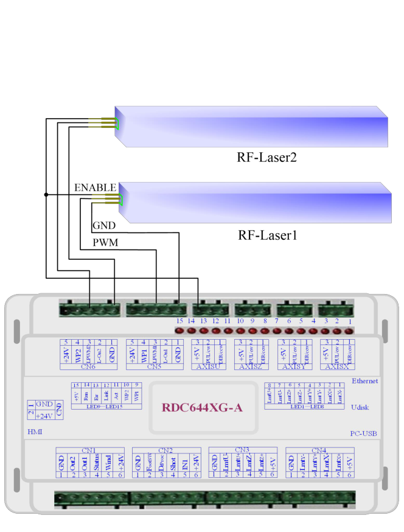

   Figura 5.3. Ejemplo de conexión para láseres RF (figura original).

6. Ejemplos de interfaz de driver para motor paso a paso/servo
==============================================================

6.1 Descripción
---------------

La entrada de señal del driver del motor paso a paso/servo utiliza aislamiento optoacoplado. Para las señales de impulsos, algunos drivers consideran válido el cambio del diodo del optoacoplador desde corte a conducción (por ejemplo, flanco descendente válido aplicado al terminal negativo del diodo), mientras que otros utilizan el cambio de conducción a corte (flanco ascendente válido).

La indicación de flanco ascendente o descendente válido debe interpretarse respecto a la señal de pulso aplicada al terminal negativo del diodo del optoacoplador.

Algunos drivers tienen entradas independientes y otros disponen internamente de ánodo común; por ello existen configuraciones con cuatro conductores externos y otras con tres (contando únicamente pulso y dirección).

El controlador RDC644XG ofrece cuatro grupos de interfaces de tres hilos para drivers de movimiento. Cada interfaz proporciona una señal de dirección, una señal de pulso y una salida positiva de 5 V. Las señales de dirección y pulso son salidas OC.

El RDC644XG debe conectarse al driver con ánodo común. La polaridad de dirección y el flanco válido de pulso pueden modificarse en los parámetros de fábrica.

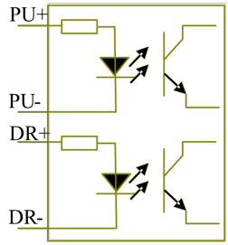

   Figura 6.1-1. Cuatro entradas, señales independientes.

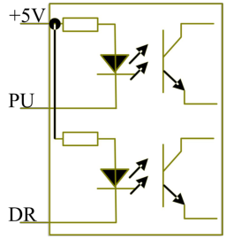

   Figura 6.1-2. Tres entradas, ánodo común.

6.2 Ejemplo de conexión del driver de motor
-------------------------------------------

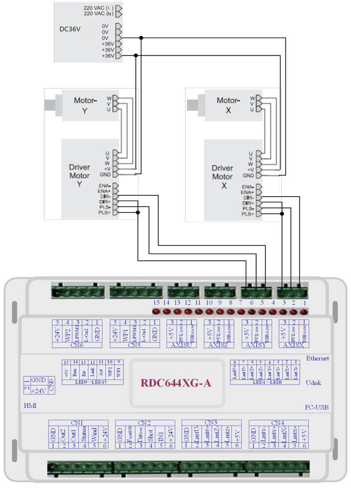

   Figura 6.2. Ejemplo de conexión de drivers de los ejes X e Y (figura original).

7. Ejemplos de cableado de puertos de E/S
=========================================

7.1 Entradas
------------

Las dos entradas de protección de agua utilizan nivel lógico de 24 V. Todas las demás entradas son compatibles con niveles lógicos de 5 V, 12 V y 24 V.

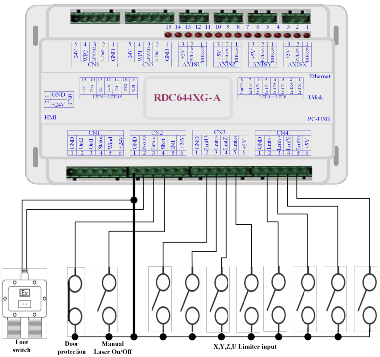

   Figura 7.1-1. Ejemplo de conexiones de entrada (figura original).

7.2 Salidas
-----------

Todas las salidas están aisladas mediante optoacopladores y admiten hasta 500 mA por canal. Son salidas OC y pueden accionar directamente relés de 6 V/24 V, lámparas LED, zumbadores y dispositivos equivalentes.

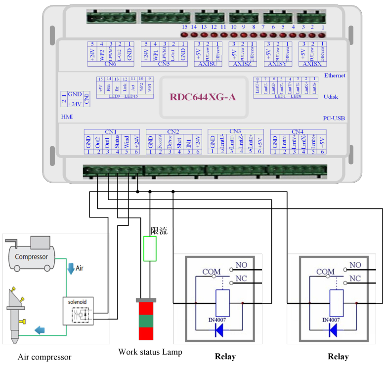

   Figura 7.2-1. Ejemplo de conexiones de salida (figura original).

8. Instrucciones de operación del panel
=======================================

8.1 Descripción
---------------

8.1.1 Vista general
~~~~~~~~~~~~~~~~~~~

El panel de control RDC6445G-HMI (en adelante, “panel”) es una interfaz hombre-máquina basada en una pantalla LCD TFT de 5,0 pulgadas. Ofrece una interfaz amigable, control fluido y una buena relación costo-prestaciones. Puede mostrar en tiempo real la trayectoria de movimiento del controlador, permitiendo visualizar de forma inmediata los gráficos en proceso. Además, admite gestión y vista previa de archivos, modificación de parámetros de usuario y fabricante, selección de idioma y otras funciones.

   Figura 8.1.1-1. Panel RDC6445G-HMI (figura original).

.. list-table::
   :widths: 36 64
   :header-rows: 1

   * - Característica
     - Especificación
   * - Pantalla
     - TFT de 5,0 pulgadas
   * - Resolución
     - 854 × 480
   * - Color
     - 64K colores
   * - Comunicación
     - Serie estándar RS232

8.1.2 Descripción de las teclas
~~~~~~~~~~~~~~~~~~~~~~~~~~~~~~~

.. list-table::
   :widths: 36 64
   :header-rows: 1
   :class: fit-table

   * - Tecla
     - Función
   * - Reset
     - Reinicia todo el sistema.
   * - Start/Pause
     - Inicia o pausa el trabajo.
   * - Pulse / Laser
     - Emite un pulso de láser o activa el láser según el modo configurado.
   * - Stop
     - Detiene el trabajo o el movimiento de los ejes.
   * - Focus
     - Ejecuta la búsqueda automática de enfoque.
   * - Menu
     - Accede a parámetros de usuario, parámetros de fábrica, idioma y otras opciones.
   * - Frame
     - Recorre el contorno del archivo actual.
   * - File
     - Gestiona archivos de memoria interna y memoria USB.
   * - Origin
     - Establece el origen relativo.
   * - Power
     - Ajusta la potencia láser de la capa en ejecución o la potencia usada por la tecla Laser.
   * - Shift
     - Conmuta funciones especiales.
   * - Speed
     - Ajusta la velocidad de la capa en ejecución o la velocidad de movimiento mediante teclas de dirección.
   * - Esc
     - Detiene determinadas operaciones o sale de un menú.
   * - Enter
     - Confirma o valida los cambios.
   * - Flechas
     - Mueven los ejes X e Y y permiten navegar por las opciones de menú.
   * - Z↑ / Z↓
     - Mueven el eje Z.
   * - U+ / U-
     - Mueven el eje U.
   * - Jog/Continuous
     - Conmuta entre movimiento por pasos y movimiento continuo.
   * - Punto decimal
     - Introduce el separador decimal.
   * - Retroceso
     - Borra el carácter anterior.
   * - Teclas 0-9
     - Permiten introducir valores numéricos para los parámetros.

8.2 Interfaz principal
----------------------

Al encender el sistema se muestra la interfaz principal.

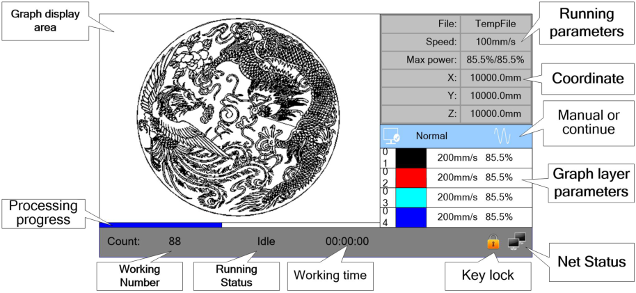

   Figura 8.2. Interfaz principal del panel (figura original).

* Área de visualización gráfica: muestra la trayectoria completa del archivo y la trayectoria recorrida durante la ejecución.
* Parámetros de ejecución: muestra número de archivo, velocidad, potencia máxima y otros datos del archivo en ejecución.
* Coordenadas: muestra las coordenadas actuales de los ejes X, Y y Z.
* Parámetros de capas: muestra información de las capas del archivo actual, como potencia máxima/mínima y velocidad. Con el sistema en reposo, al seleccionar una capa puede modificarse su configuración y guardarse.
* Estado de ejecución: indica estados como Inactivo, Ejecutando, Pausa o Finalizado.
* Barra de progreso: muestra el progreso del archivo actual.
* Número de trabajos: acumula la cantidad de ejecuciones del archivo actual.
* Dimensiones del archivo: muestra el tamaño del archivo actual.
* Estado de red: indica el estado de la conexión Ethernet.
* Estado de bloqueo de teclas: cuando el bloqueo está habilitado se muestra su icono; cualquier pulsación solicita la contraseña de desbloqueo.

Cuando el equipo está inactivo o ha finalizado el trabajo, todas las teclas están disponibles y se puede seleccionar un archivo, modificar parámetros o previsualizar. Durante la ejecución o una pausa, algunas teclas quedan deshabilitadas.

8.2 Ajuste de velocidad
------------------------

En la interfaz principal pulse <Speed>. Introduzca o modifique el valor con las teclas numéricas y Retroceso. Pulse <Enter> para guardar o <Esc> para cancelar y volver a la interfaz principal.

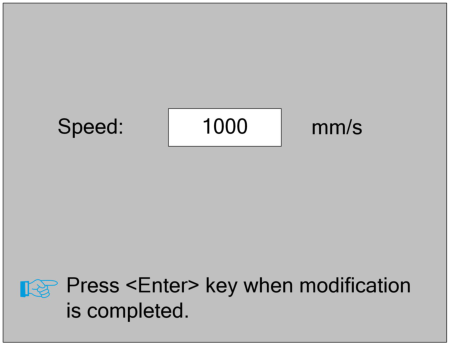

   Figura 8.2. Pantalla de ajuste de velocidad (figura original).

8.3 Ajuste de potencia máxima/mínima
------------------------------------

En la interfaz principal pulse <Power>. El bloque de selección azul queda sobre el primer parámetro. Utilice las teclas numéricas y Retroceso para modificarlo, y las flechas para seleccionar otros parámetros. Pulse <Enter> para guardar los cambios o <Esc> para cancelarlos y volver a la interfaz principal.

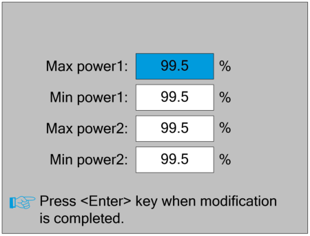

   Figura 8.3. Ajuste de potencia máxima/mínima (figura original).

8.4 Configuración de parámetros de capa
---------------------------------------

Después de seleccionar un archivo para previsualizarlo, si el área de parámetros contiene información de capas, pulse <Enter> para desplazar el cursor a la primera capa. Utilice las teclas Arriba/Abajo para seleccionar la capa deseada y pulse <Enter> para consultar sus parámetros.

Cuando el bloque azul se encuentre sobre el número de capa, pulse <Enter> para entrar en el modo de selección; use Arriba/Abajo para elegir otra capa y vuelva a pulsar <Enter> para salir de ese modo. A continuación, use Arriba/Abajo para moverse al parámetro que desea modificar y edítelo con las teclas numéricas y Retroceso. Para guardar, mueva el bloque a “Write parameters” y pulse <Enter>. Si no se ejecuta esta acción, los cambios no se guardan. Pulse <Esc> para regresar a la interfaz principal.

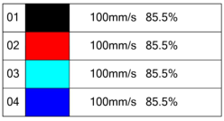

   Figura 8.4-1. Información de capas.

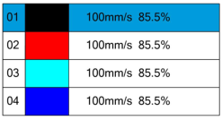

   Figura 8.4-2. Selección de capa.

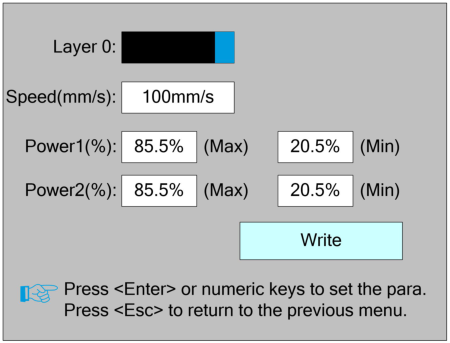

   Figura 8.4-3. Parámetros de la capa seleccionada.

8.5 Función de menú
-------------------

Pulse <Menu> desde la interfaz principal para abrir el menú. Pulse <Esc> para regresar al menú anterior.

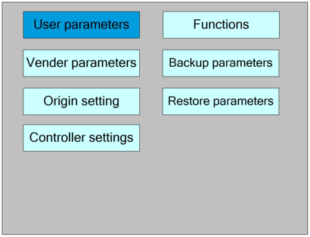

   Figura 8.5. Menú principal de configuración (figura original).

8.5.1 Parámetros de usuario
~~~~~~~~~~~~~~~~~~~~~~~~~~~

En el menú seleccione “User parameters” y pulse <Enter>. El panel leerá automáticamente los parámetros de la placa principal y mostrará el progreso en “Read Parameters”. Cuando finalice la lectura, utilice Arriba/Abajo para seleccionar una categoría, por ejemplo corte, alimentación o enfoque. El área derecha muestra los parámetros correspondientes. Si no desea modificarlos, pulse <Esc>.

Para modificar parámetros, pulse <Enter>; el bloque azul pasará al primer parámetro del área. Seleccione un parámetro con Arriba/Abajo. Para valores numéricos utilice las teclas numéricas. Para valores no numéricos, pulse <Enter> para entrar al modo de edición, cambie la opción con Arriba/Abajo y pulse <Enter> para salir. Después de modificar una página, seleccione “Write” y pulse <Enter> para guardar los valores en la placa. Para comprobarlos, seleccione “Read” y pulse <Enter>. Con Izquierda/Derecha se regresa a la selección de categorías.

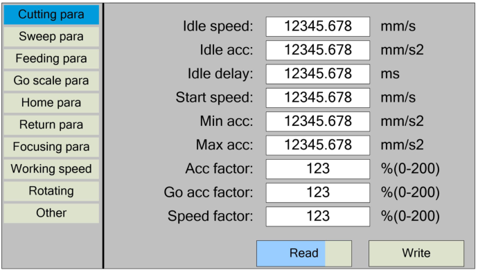

   Figura 8.5.1-1. Parámetros de usuario.

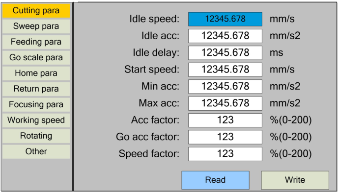

   Figura 8.5.1-2. Edición de parámetros.

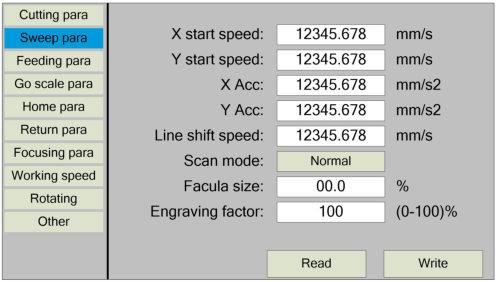

   Figura 8.5.1-3. Parámetros de corte.

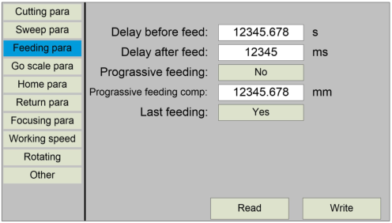

   Figura 8.5.1-4. Parámetros de alimentación.

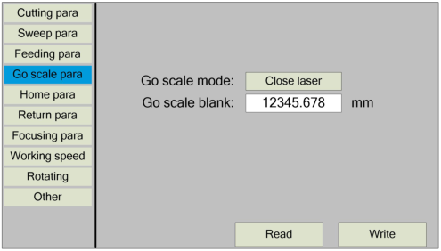

   Figuras 8.5.1-5 a 8.5.1-11. Pantallas adicionales de parámetros de usuario.

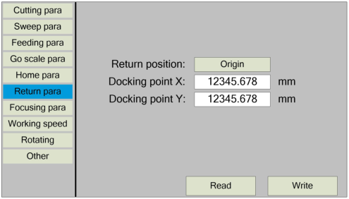

   Figuras 8.5.1-5 a 8.5.1-11. Pantallas adicionales de parámetros de usuario.

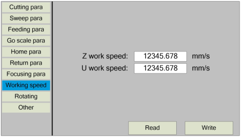

   Figuras 8.5.1-5 a 8.5.1-11. Pantallas adicionales de parámetros de usuario.

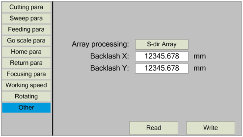

   Figuras 8.5.1-5 a 8.5.1-11. Pantallas adicionales de parámetros de usuario.

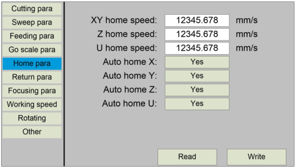

   Figuras 8.5.1-5 a 8.5.1-11. Pantallas adicionales de parámetros de usuario.

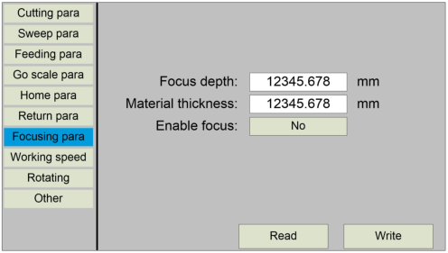

   Figuras 8.5.1-5 a 8.5.1-11. Pantallas adicionales de parámetros de usuario.

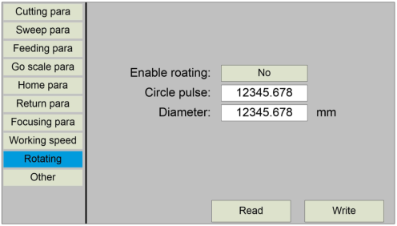

   Figuras 8.5.1-5 a 8.5.1-11. Pantallas adicionales de parámetros de usuario.

8.5.2 Parámetros del fabricante
~~~~~~~~~~~~~~~~~~~~~~~~~~~~~~~

En el menú seleccione “Vender parameters” y pulse <Enter>. Los parámetros de los ejes Y, Z y U tienen una estructura equivalente a los del eje X. La operación y el método de configuración de los parámetros de fábrica son los mismos que para los parámetros de usuario.

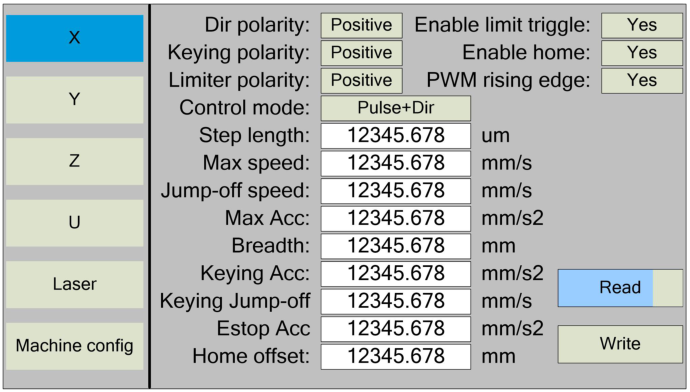

   Figura 8.5.2-1. Parámetros de fabricante.

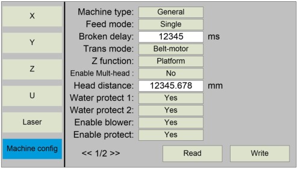

   Figura 8.5.2-2. Parámetros de eje.

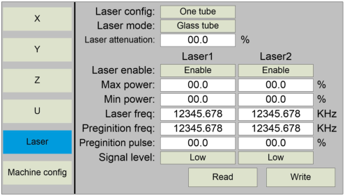

   Figura 8.5.2-3. Parámetros láser.

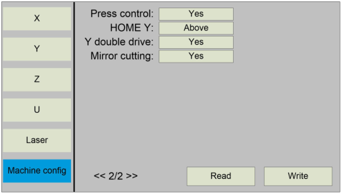

   Figura 8.5.2-4. Otros parámetros.

8.5.3 Configuración de orígenes
~~~~~~~~~~~~~~~~~~~~~~~~~~~~~~~

En el menú seleccione “Origin setting” y pulse <Enter>. El bloque azul selecciona inicialmente “Mult origin enable”. Pulse <Enter> para habilitar o deshabilitar esta función; cuando está habilitada, el cuadro pequeño de la derecha se muestra en rojo.

Para configurar el origen 1, seleccione “Origin 1 enable” y pulse <Enter> para habilitarlo. Pulse <Shift> y use las teclas de dirección para modificar las coordenadas X/Y. Pulse <Origin> para guardar las coordenadas actuales como origen 1 y finalmente pulse <Shift> para volver a la operación normal de la pantalla. Los demás orígenes se configuran del mismo modo.

Cuando el bloque de selección esté en “Start origin”, pulse <Enter> para editar, cambie el valor con Arriba/Abajo y vuelva a pulsar <Enter> para aplicar. Pulse <Esc> para regresar.

* Habilitar múltiples orígenes: “No” utiliza la lógica de un solo origen y permite establecerlo con la tecla <Origin>. “Sí” activa la lógica de múltiples orígenes y deshabilita la tecla <Origin> para esta función; cada origen se configura desde el menú.
* Origin Enable 1/2/3/4: permite habilitar o deshabilitar cada uno de los cuatro orígenes de forma independiente.
* Start Origin: valores 0 a 4. El origen 0 corresponde al origen establecido con la tecla <Origin> en modo de origen único. Los valores 1 a 4 corresponden a los orígenes de la lógica múltiple. El origen inicial puede seleccionarse entre 1 y 4, siempre que esté habilitado; no puede establecerse en 0 desde este parámetro.

.. note::

   Si se habilitan los cuatro orígenes y el origen siguiente es el 1, cuando se inicia un archivo de memoria o se carga un archivo desde el PC con la opción de usar el origen original como origen actual, cada trabajo utilizará un origen distinto siguiendo el orden 1→2→3→4→1→2…

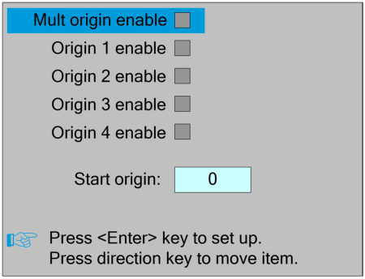

   Figura 8.5.3-1. Configuración de orígenes.

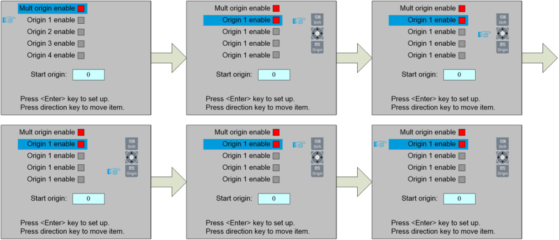

   Figura 8.5.3-2. Proceso de ajuste del origen.

8.5.4 Copia de seguridad de parámetros
~~~~~~~~~~~~~~~~~~~~~~~~~~~~~~~~~~~~~~

Seleccione “Backup Factory Parameters” y pulse <Enter>. Aparecerá la interfaz de contraseña; el procedimiento se describe en la sección 8.9. Si la contraseña es correcta, el sistema realizará una copia de seguridad de todos los parámetros de usuario y de fábrica y mostrará un mensaje indicando que la copia se completó correctamente.

.. note::

   Una vez que el fabricante ha ajustado correctamente todos los parámetros de la máquina, esta función permite guardar la configuración para poder recuperarla posteriormente si se modifican valores de forma incorrecta.

8.5.5 Restauración de parámetros
~~~~~~~~~~~~~~~~~~~~~~~~~~~~~~~~

Seleccione “Restore Factory Parameters” y pulse <Enter>. Introduzca la contraseña según la sección 8.9. Si es correcta, el sistema restaurará los parámetros de usuario y de fábrica utilizando la copia almacenada previamente y mostrará el mensaje de recuperación correcta.

8.6 Ajustes del controlador
---------------------------

Seleccione “Controller Settings” en el menú y pulse <Enter>. Pulse <Esc> para volver al menú anterior.

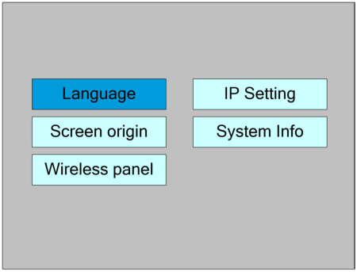

   Figura 8.6. Ajustes del controlador (figura original).

8.6.1 Idioma
~~~~~~~~~~~~

Seleccione “Language” y pulse <Enter>. Utilice las teclas de dirección para seleccionar un idioma y pulse <Enter> para aplicarlo. El sistema regresará automáticamente al menú.

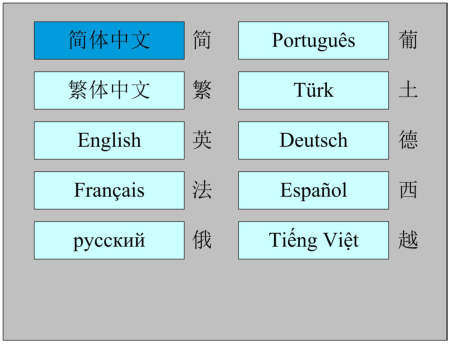

   Figura 8.6.1. Selección de idioma (figura original).

8.6.2 Origen de pantalla
~~~~~~~~~~~~~~~~~~~~~~~~

Seleccione “Screen origin” y pulse <Enter>. Aquí se define el origen de la pantalla. La elección de un origen diferente cambia la posición de la representación gráfica en las direcciones X o Y. Seleccione una opción con las teclas de dirección y pulse <Enter> para aplicarla; pulse <Esc> para volver a la interfaz principal.

.. caution::

   Este ajuste solo afecta la vista previa del archivo en la pantalla y no modifica el movimiento de la máquina.

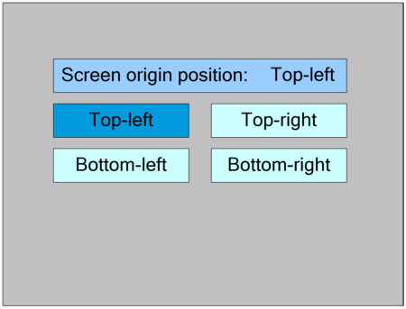

   Figura 8.6.2. Origen de pantalla (figura original).

8.6.3 Panel inalámbrico
~~~~~~~~~~~~~~~~~~~~~~~

Seleccione “Wireless panel” y pulse <Enter>. Para modificar el primer parámetro, pulse <Enter> para entrar al modo de edición, cambie el valor con Arriba/Abajo y pulse <Enter> para salir. Use las teclas de dirección para seleccionar otros parámetros y las teclas numéricas para editarlos. Para aplicar los cambios, seleccione “Write” y pulse <Enter>. Pulse <Esc> para volver al menú anterior.

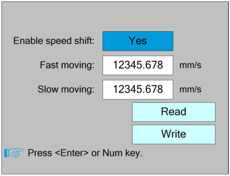

   Figura 8.6.3. Configuración del panel inalámbrico (figura original).

8.6.4 Configuración IP
~~~~~~~~~~~~~~~~~~~~~~

Seleccione “IP setting” y pulse <Enter>. Seleccione el parámetro con las teclas de dirección y modifíquelo con las teclas numéricas. Después, seleccione “Write” y pulse <Enter> para aplicar la configuración. Pulse <Esc> para regresar.

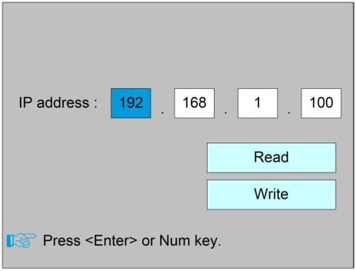

   Figura 8.6.4. Configuración IP (figura original).

8.6.5 Información del sistema
~~~~~~~~~~~~~~~~~~~~~~~~~~~~~

Seleccione “System Info” y pulse <Enter>. Pulse <Enter> para leer la información de la placa principal. Pulse <Esc> para volver al menú anterior.

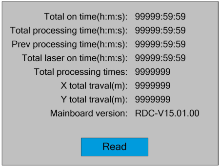

   Figura 8.6.5. Información del sistema (figura original).

8.7 Funciones
-------------

En el menú seleccione “Function” y pulse <Enter>. Pulse <Esc> para regresar al menú anterior.

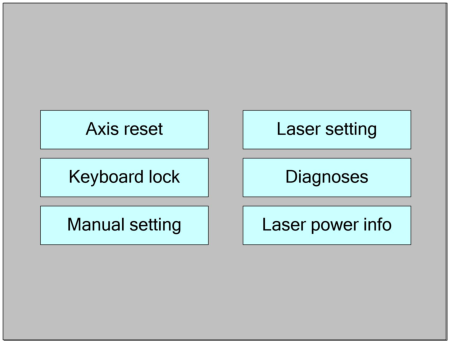

   Figura 8.7. Menú de funciones (figura original).

8.7.1 Reinicio de ejes
~~~~~~~~~~~~~~~~~~~~~~

Seleccione “Axis reset” y pulse <Enter>. Seleccione un eje con las teclas de dirección y pulse <Enter>. El sistema ejecutará el reinicio del eje y mostrará “Resetting…”. Pulse <Esc> para regresar.

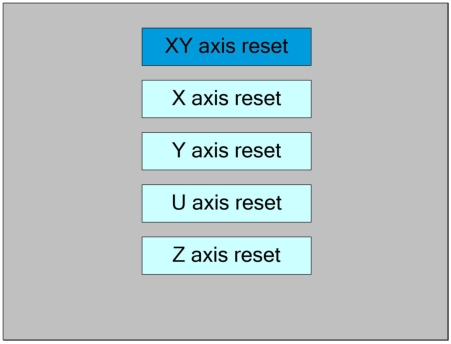

   Figura 8.7.1. Reinicio de ejes (figura original).

8.7.2 Bloqueo del teclado
~~~~~~~~~~~~~~~~~~~~~~~~~

Seleccione “Keyboard lock” y pulse <Enter>. La opción de contraseña permite definir la contraseña predeterminada utilizada para bloquear el teclado. La opción de bloqueo de teclas bloquea el teclado después de introducir la contraseña correcta y regresa a la interfaz principal. Posteriormente, al pulsar cualquier tecla, el panel solicitará la contraseña de desbloqueo. Consulte la sección 8.9 para el ingreso y configuración de contraseñas.

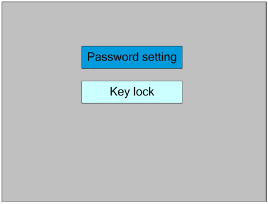

   Figura 8.7.2. Bloqueo del teclado (figura original).

8.7.3 Configuración manual
~~~~~~~~~~~~~~~~~~~~~~~~~~

Seleccione “Manual setting” y pulse <Enter>. El modo manual dispone de las opciones “Continue” y “Manual”. Pulse <Enter> para entrar al modo de edición, modifique con Arriba/Abajo y pulse <Enter> para salir. Después de efectuar los cambios, seleccione “Write Parameters” y pulse <Enter> para aplicarlos.

En modo “Continue”, el parámetro “Manual” no es válido: al mantener presionada una tecla de dirección, el eje se mueve y se detiene al soltarla. En modo “Manual”, cada pulsación de una tecla de dirección desplaza el eje una distancia fija, salvo que se exceda el recorrido permitido.

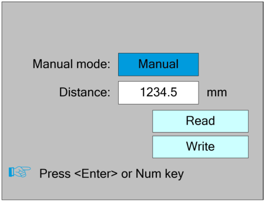

   Figura 8.7.3. Ajustes del movimiento manual (figura original).

8.7.4 Ajuste del láser
~~~~~~~~~~~~~~~~~~~~~~

Seleccione “Laser setting” y pulse <Enter>. El método de operación es equivalente al ajuste manual. En modo “Continue”, el parámetro de tiempo de láser no es válido: el láser permanece activo mientras se mantiene presionada la tecla Laser y se desactiva al soltarla. En modo “Manual”, una pulsación de la tecla Laser emite durante el tiempo fijo configurado.

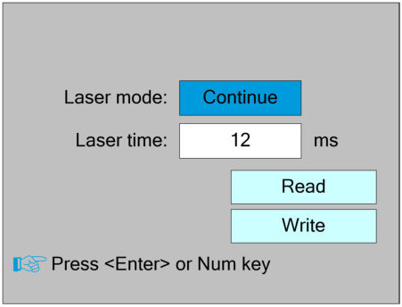

   Figura 8.7.4. Ajuste del láser (figura original).

8.7.5 Diagnóstico
~~~~~~~~~~~~~~~~~

Seleccione “Diagnose” y pulse <Enter>. La pantalla muestra la información de E/S del hardware. Pulse <Enter> para leer el estado del sistema. Cuando una señal de hardware está activa, el pequeño cuadro situado a la izquierda de la entrada correspondiente se muestra en rojo; en caso contrario se muestra en gris. Pulse <Esc> para regresar.

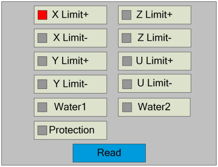

   Figura 8.7.5. Pantalla de diagnóstico (figura original).

8.7.6 Información de la fuente láser
~~~~~~~~~~~~~~~~~~~~~~~~~~~~~~~~~~~~

La función de información de la fuente láser debe configurarse previamente desde el software de PC. Seleccione “Laser power info” y pulse <Enter>. Cuando el bloque azul se sitúe sobre las fuentes 1, 2, 3 o 4, pulse <Enter> para consultar la información de cada fuente.

Cuando el bloque azul esté en “diagnostic TL” o “diagnostic TH”, pulse <Enter> para comprobar si existe una anomalía en las E/S de la fuente de alimentación láser; si se detecta una anomalía se genera una alarma.

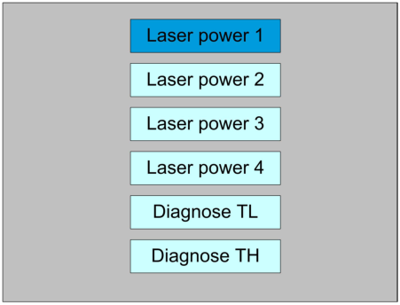

   Figura 8.7.6-1. Información de fuente láser.

   Figura 8.7.6-2. Detalle de la fuente láser.

8.8 Gestión de archivos
-----------------------

8.8.1 Archivos de memoria
~~~~~~~~~~~~~~~~~~~~~~~~~

Desde la interfaz principal pulse <Menu> y acceda a la gestión de archivos. El sistema lee primero los archivos almacenados en memoria y muestra su nombre y número de ejecuciones. El archivo seleccionado se previsualiza en el área inferior derecha. Use Arriba/Abajo para mover el cursor por la lista. Con el cursor sobre un archivo, pulse <Enter> para previsualizarlo en la interfaz principal; pulse <Esc> para cerrar la vista previa. Izquierda/Derecha permite desplazarse entre las opciones laterales.

* Run: ejecuta el archivo seleccionado.

* Track: recorre el contorno del archivo seleccionado; el modo de recorrido es configurable.

* Work time: estima el tiempo de ejecución del archivo seleccionado con precisión de 1 ms.

* Clear count: borra el contador de ejecuciones del archivo seleccionado.

* Copy to U disk: copia el archivo seleccionado a la memoria USB.

* Delete: elimina el archivo seleccionado de la memoria interna.

* U disk: abre la lista de archivos de la memoria USB.

* Memory operation: abre otras operaciones sobre los archivos de memoria.

* Read mem file: vuelve a leer la lista de archivos de memoria.

   Figura 8.8.1. Gestión de archivos en memoria (figura original).

8.8.2 Operaciones de memoria
~~~~~~~~~~~~~~~~~~~~~~~~~~~~

Seleccione “Memory Operation” y pulse <Enter>. Las opciones son:

* Clear all count: borra el número de ejecuciones de todos los archivos de memoria.

* Delete all file: elimina todos los archivos de la memoria.

* Format memory: formatea la memoria y elimina todos los archivos almacenados.

* Total: muestra el número total de ejecuciones de todos los archivos.

El método de operación es el mismo que en las pantallas anteriores. Pulse <Esc> para regresar.

   Figura 8.8.2. Operaciones de memoria (figura original).

8.8.3 Formateo de memoria
~~~~~~~~~~~~~~~~~~~~~~~~~

Seleccione “Format Memory” y pulse <Enter>.

* Format speedily: formateo rápido; elimina todos los archivos de la memoria.
* Format drastically: formateo completo; elimina todos los archivos de la memoria.

Pulse <Esc> para regresar al menú anterior.

   Figura 8.8.3. Formateo de memoria (figura original).

8.8.4 Archivos de memoria USB
~~~~~~~~~~~~~~~~~~~~~~~~~~~~~

Al seleccionar “U disk” en la pantalla de archivos, se abre la lista de archivos de la memoria USB. El método de operación es equivalente al de la memoria interna.

* Read Udisk: lee la lista de archivos de la memoria USB.
* Copy to memory: copia el archivo seleccionado de la memoria USB a la memoria interna.
* Delete: elimina el archivo seleccionado de la memoria USB.

   Figura 8.8.4. Gestión de memoria USB (figura original).

.. note::

   El sistema admite memorias USB formateadas en FAT32 y FAT16. Los archivos deben estar en el directorio raíz. Los nombres de más de 8 caracteres pueden truncarse automáticamente. Los archivos copiados desde la placa a la memoria USB se guardan en el directorio raíz.

8.9 Ingreso y configuración de contraseñas
------------------------------------------

8.9.1 Ingreso de contraseña
~~~~~~~~~~~~~~~~~~~~~~~~~~~

Al acceder a determinadas interfaces u operaciones se solicita una contraseña. Puede introducirla directamente con las teclas numéricas o seleccionar números y letras con las teclas de dirección y confirmar cada carácter con <Enter>. Una vez introducidos los seis caracteres, pulse <Enter>. Si la contraseña es correcta se abrirá la interfaz correspondiente o se ejecutará la operación; de lo contrario aparecerá “password error” y deberá introducirla nuevamente. Pulse <Esc> para volver.

   Figura 8.9.1. Ingreso de contraseña (figura original).

8.9.2 Configuración de contraseña
~~~~~~~~~~~~~~~~~~~~~~~~~~~~~~~~~

En la pantalla de configuración puede introducir la contraseña con las teclas numéricas o pulsar <Shift> para utilizar el teclado de caracteres. Seleccione un número o letra con las teclas de dirección y pulse <Enter>. Pulse <Shift> para volver a la selección de contraseña. Si la contraseña se introduce correctamente, la nueva contraseña entra en vigor; en caso contrario se muestra “password error”. Pulse <Esc> para volver.

   Figura 8.9.2. Configuración de contraseña (figura original).

8.10 Mensajes y alarmas
-----------------------

Durante la operación del usuario o del sistema pueden aparecer mensajes y alarmas, por ejemplo: reinicio, fallo de protección de agua, protección por límite físico o cruce del borde de trabajo.

* Mensaje: durante un reinicio el sistema muestra “The system is resetting.” El usuario debe actuar de acuerdo con las indicaciones de la pantalla.
* Alarma: ante un fallo de protección de agua el sistema muestra una alarma de “water protection fault”. El sistema realiza la operación correspondiente según se pulse <Enter> o <Esc>.

   Figura 8.10-1. Mensaje de reinicio.

   Figura 8.10-2. Alarma de protección de agua.

9. Explicación de parámetros de fabricante y usuario
====================================================

9.1 Parámetros del fabricante
-----------------------------

9.1.1 Parámetros del motor
~~~~~~~~~~~~~~~~~~~~~~~~~~

Los parámetros siguientes se aplican a los ejes X, Y, Z y U:

Polaridad de dirección: Invertir la polaridad cambia el sentido de movimiento del motor. Debe configurarse de modo que el eje se desplace hacia el origen durante el reinicio. Si se aleja del origen, la polaridad es incorrecta.

Polaridad de límite: Define si la señal de límite es activa a nivel alto o bajo. Si al llegar al límite la placa recibe nivel bajo, la polaridad debe configurarse como negativa.

Recorrido (Scope): Distancia máxima que puede recorrer el eje, determinada por la construcción real de la máquina.

Distancia del origen al límite físico: Si se habilita la protección por límite físico, normalmente debe ajustarse entre 2 y 5 mm. Un valor de 0 puede provocar activaciones erróneas al llegar a la coordenada mínima. Si la protección no está habilitada, puede ajustarse entre 0 y 5 mm.

Modo de control: Puede seleccionarse doble pulso o dirección + pulso único. Normalmente se utiliza dirección + pulso único.

Paso del motor: Equivalencia de desplazamiento: distancia absoluta que recorre el eje por cada pulso enviado al motor. Antes de establecerla correctamente puede cortarse un rectángulo grande y calcular automáticamente el valor a partir de la longitud programada y la longitud medida.

Protección por límite físico: Habilita o deshabilita la protección por límite físico del eje.

Flanco ascendente PWM válido: Define si el driver considera válido el flanco ascendente o descendente de la señal de pulsos. Deshabilitado = flanco descendente; habilitado = flanco ascendente.

Habilitar reinicio: Si la máquina dispone de ese eje, debe habilitarse su reinicio; si no existe, debe deshabilitarse.

Velocidad de arranque: Velocidad del eje al iniciar directamente desde reposo. Un valor demasiado alto puede provocar pérdida de pasos, vibración o ruido; uno demasiado bajo reduce la velocidad global. Los ejes de mayor inercia requieren valores menores. Valor típico: 5 a 30 mm/s.

Velocidad máxima: Límite máximo de velocidad que puede soportar el eje, relacionado con la fuerza del motor, la inercia y la relación de transmisión. Valor típico: 200 a 500 mm/s.

Aceleración máxima: Aceleración máxima en aceleración o desaceleración. Un valor excesivo puede causar pérdida de pasos, vibración o ruido; uno demasiado bajo reduce la velocidad general. En ejes de mayor inercia, como Y asociado al puente, el rango típico es 800 a 3000 mm/s²; en ejes de menor inercia, como X asociado al carro, 8000 a 20000 mm/s².

Aceleración de parada de emergencia: Si el eje utiliza protección por límite físico, al alcanzar el límite se detendrá con esta aceleración. Puede configurarse entre 2 y 3 veces la aceleración máxima del eje.

Parámetros de las teclas de movimiento
~~~~~~~~~~~~~~~~~~~~~~~~~~~~~~~~~~~~~~

Velocidad inicial por teclado: Velocidad inicial del eje cuando se mueve mediante las teclas del panel. No puede ser superior a la velocidad de arranque.

Aceleración por teclado: Aceleración utilizada al mover el eje con las teclas. No puede ser superior a la aceleración máxima del eje.

Polaridad de teclas: Controla la dirección del eje durante el movimiento manual. Si las teclas de dirección provocan un movimiento opuesto al esperado, debe modificarse esta polaridad.

9.1.2 Parámetros del láser
~~~~~~~~~~~~~~~~~~~~~~~~~~

Configuración del láser: Permite seleccionar uno o dos láseres, según la cantidad de tubos instalada por el fabricante.

Tipo de láser: Opciones: tubo de vidrio, láser RF sin pulso de preignición y láser RF con pulso de preignición.

Coeficiente de atenuación del láser: Permite compensar la pérdida de potencia del láser.

Habilitar láser: Con dos láseres instalados, cada uno puede habilitarse o deshabilitarse de forma independiente.

Potencia mínima: Define el límite mínimo de potencia permitido.

Potencia máxima: Define el límite máximo de potencia permitido.

Frecuencia PWM del láser: Define la frecuencia de pulsos de la señal de control. Como referencia, un tubo de vidrio suele utilizar aproximadamente 20 kHz y un láser RF aproximadamente 5 kHz.

Frecuencia de pre-generación: Se utiliza con láseres RF que requieren pre-generación de PWM.

Escala de pulso de pre-generación: Se configura junto con la frecuencia de pre-generación cuando el láser RF requiere PWM previo.

Protección de agua habilitada: Si está habilitada, la placa supervisa la entrada de protección de agua. Nivel bajo = normal; nivel alto = cierre forzado del láser, pausa del trabajo y alarma. Si está deshabilitada, la entrada no se supervisa.

Los valores de potencia máxima y mínima (%) establecen los límites permitidos para el usuario. Durante la operación, el usuario no puede superar la potencia máxima definida aquí ni configurar una potencia inferior al mínimo definido. Cuando la potencia del láser disminuye por envejecimiento, puede utilizarse el coeficiente de atenuación para compensarla.

.. note::

   Si la máquina dispone de un solo láser, se mostrará únicamente el conjunto de parámetros correspondiente a un canal.

9.1.3 Otros parámetros del fabricante
~~~~~~~~~~~~~~~~~~~~~~~~~~~~~~~~~~~~~

Configuración de la máquina:

Tipo de máquina: En la mayoría de los casos debe seleccionarse la máquina de grabado general. Los demás tipos se reservan para aplicaciones específicas.

Modo de transmisión: Normalmente se selecciona “Belt Stepping Type” (transmisión por correa con motor paso a paso). Al seleccionar otros tipos, el algoritmo de control cambia ligeramente.

Modo de alimentación: Puede ser unidireccional o bidireccional. En modo unidireccional no es necesario comprobar coordenadas. En modo bidireccional el sistema comprueba coordenadas máxima y mínima: las secuencias impares alimentan en una dirección y las pares en la contraria. La dirección inicial puede cambiarse mediante la polaridad de dirección o el signo de la longitud de alimentación.

Retardo de reanudación tras corte de energía: Ajustable entre 0 y 3000 ms. Tras un corte de la red, la tensión del sistema no cae instantáneamente a cero. Este valor debe aproximarse al retardo real. Si difiere demasiado, al reanudar un grabado continuo la segunda parte puede quedar separada de la anterior o superponerse excesivamente.

.. note::

   Después de modificar parámetros de fabricante como polaridad de dirección, modo de control, tipo de láser o frecuencia PWM, debe reiniciarse el sistema para que los cambios entren en vigor.

Parámetros de habilitación:

Protección de puerta abierta: Si está habilitada, la protección de puerta debe estar conectada al controlador; de lo contrario la máquina no funcionará.

Habilitar soplador: Si el puerto Wind se utiliza para controlar el soplador mediante los parámetros de capa, esta opción debe habilitarse. Si no se habilita, la salida Wind puede utilizarse para otra señal.

9.2 Parámetros de usuario
-------------------------

9.2.1 Parámetros de corte
~~~~~~~~~~~~~~~~~~~~~~~~~

Velocidad de movimiento en vacío: Define la velocidad máxima de todos los movimientos sin emisión láser.

Aceleración de movimiento en vacío: Aceleración máxima de los movimientos sin emisión. Puede aumentarse junto con la velocidad para reducir el tiempo total de trabajo, pero valores excesivos pueden provocar vibraciones en la trayectoria.

Retardo de movimiento en vacío: Si el valor es cero, no hay retardo después del desplazamiento en vacío. Con un valor distinto de cero se introduce un retardo y la velocidad disminuye hasta la velocidad de detención.

Velocidad de giro: Velocidad en las esquinas de ángulo agudo; también constituye la velocidad máxima del proceso de corte en dichas condiciones.

Aceleración de giro: Aceleración en las esquinas agudas durante el corte. Valores demasiado altos pueden causar vibración; demasiado bajos reducen la velocidad de corte. Es el valor mínimo de aceleración utilizado dentro de la geometría.

Aceleración de corte: Valor máximo de aceleración utilizado durante el proceso de corte.

Factor de aceleración (Acc Factor): Indica la rapidez con la que cambia la aceleración de corte.

Factor de aceleración G0: Indica la rapidez con la que cambia la aceleración durante movimientos en vacío.

Factor de velocidad: Determina la velocidad de corte en arcos con diferentes curvaturas.

.. note::

   “Key Setting” es un botón, no un parámetro. Se utiliza para cargar valores de corte recomendados basados en experiencia.

9.2.2 Parámetros de escaneo
~~~~~~~~~~~~~~~~~~~~~~~~~~~

* Velocidad inicial del eje X
* Velocidad inicial del eje Y
* Aceleración del eje X
* Aceleración del eje Y

Estos cuatro parámetros determinan la velocidad inicial y la aceleración de los dos ejes durante el escaneo. Cuanto mayores sean, más rápido será el proceso, dentro de los límites mecánicos del sistema.

Velocidad de avance de línea en escaneo: controla la velocidad máxima con la que se pasa verticalmente de una línea a la siguiente. Si el espaciado entre líneas o bloques es grande y se requiere alta precisión de posicionamiento, conviene usar un valor menor.

Modo de escaneo: puede ser General o Especial. En modo Especial debe aumentarse la potencia láser. Cuanto menor sea el porcentaje de punto (speckle), mayor será la reducción de potencia efectiva y, por tanto, mayor deberá ser la potencia configurada para lograr la misma profundidad. El modo Especial busca aplicar alta potencia durante tiempos cortos para conseguir un fondo más plano en grabados profundos. Una configuración inadecuada puede no producir el efecto deseado y el uso de alta potencia, aunque sea por intervalos breves, puede afectar la vida útil del láser. El modo predeterminado es General.

Tamaño de punto (Speckle Size): en modo General no tiene efecto. En modo Especial se activa y el controlador permite valores entre 50 % y 99 %.

.. note::

   Los parámetros de corte y escaneo no pueden superar los límites establecidos en los parámetros de los ejes. Si se intenta hacerlo, el sistema sustituirá automáticamente los valores por los límites del eje.

9.2.3 Parámetros de alimentación
~~~~~~~~~~~~~~~~~~~~~~~~~~~~~~~~

Retardo antes de alimentar: Ajustable entre 0 y 300 s. Facilita las tareas de carga y retirada de material en el dispositivo de alimentación.

Retardo después de alimentar: Ajustable entre 0 y 9,9 s. Permite esperar a que desaparezcan las vibraciones después de alcanzar la posición correcta antes de iniciar el siguiente trabajo.

Alimentación progresiva: Si se habilita, el patrón de matriz virtual en dirección Y se ejecuta en la misma posición; después de procesar una línea, el eje U avanza una vez. La distancia de avance de U corresponde al intervalo entre dos líneas en Y.

Compensación de alimentación progresiva: Permite compensar el error de movimiento del eje U ajustando el intervalo entre las líneas del gráfico en dirección Y.

9.2.4 Parámetros de reinicio
~~~~~~~~~~~~~~~~~~~~~~~~~~~~

Velocidad de reinicio: velocidad utilizada durante el retorno coordinado de los ejes X/Y al origen.

* Reinicio del eje X al arrancar (Auto home)
* Reinicio del eje Y al arrancar (Auto home)
* Reinicio del eje Z al arrancar (Auto home)
* Reinicio del eje U al arrancar (Auto home)

En los cuatro parámetros anteriores se puede seleccionar “Sí” o “No” para definir si cada eje realiza el retorno al origen durante el arranque.

9.2.5 Parámetros de recorrido de contorno (Go Scale)
~~~~~~~~~~~~~~~~~~~~~~~~~~~~~~~~~~~~~~~~~~~~~~~~~~~~

Modo Go Scale: “Blanked Bordering” realiza una vista previa del contorno sin emitir láser; “Outputted Border Cutting” permite cortar manualmente el contorno del gráfico procesado; “4-corner Dotting” emite el láser brevemente en las cuatro esquinas del marco para marcar puntos. Esto permite comprobar de forma intuitiva el tamaño y la posición. La velocidad del contorno es la configurada mediante el teclado con el sistema en reposo. Para salida de luz, las potencias mínima y máxima son las configuradas en el teclado; en el modo de cuatro puntos se utiliza la potencia máxima configurada.

Margen Go Scale: define si el contorno de previsualización/corte se amplía una determinada distancia por fuera del marco real del gráfico.

.. note::

   Si el contorno excede los límites de la máquina, la interfaz mostrará un aviso. Al pulsar <Enter>, el sistema puede recorrer primero el borde de las coordenadas máximas/mínimas y después el contorno del gráfico. Es posible cancelar este recorrido.

9.2.6 Otros parámetros de usuario
~~~~~~~~~~~~~~~~~~~~~~~~~~~~~~~~~

Modo de matriz: Puede ser bidireccional o unidireccional. En modo bidireccional los elementos se procesan de ida y vuelta; en modo unidireccional se procesan siempre en la misma dirección. El modo unidireccional ofrece un comportamiento uniforme entre elementos, pero requiere algo más de tiempo. El modo predeterminado es bidireccional.

Posición de retorno: Puede seleccionarse el origen relativo o el origen absoluto de máquina. Este parámetro determina dónde se estaciona el cabezal láser al finalizar cada trabajo.

Ajuste de enfoque: Distancia desde el punto focal de la lente del cabezal hasta el origen del eje Z. Si no existe función de autoenfoque, el parámetro no tiene efecto.

Holgura X: Compensación de holgura del eje X, con precisión de 1 µm.

Holgura Y: Compensación de holgura del eje Y, con precisión de 1 µm.
